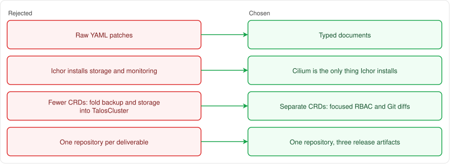

# Alternatives considered

*What Ichor chose, and what it chose against.*

| Rejected | Why |
|---|---|
| Raw YAML patches | Cannot be validated, previewed or explained in a UI, and tie user files to a Talos version. |
| Ichor installing storage and monitoring | Doubles the surface, duplicates the storage controllers, and puts Ichor on the upgrade treadmill of every project it wraps. |
| Fewer CRDs (`TalosEtcdBackup` and `TalosStorage` folded into `TalosCluster`) | Separate kinds keep RBAC and Git diffs focused. Merging later needs a migration; splitting later does not. |
| One repository per deliverable | The three deliverables share the CRD types and the Connect definitions. Separate repositories need a fourth one for those, and version skew. |
