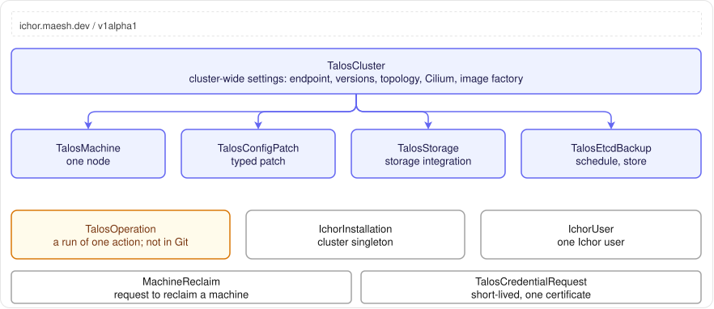

# API

Group `ichor.maesh.dev`, version `v1alpha1`.

*The kinds of the API and how they relate.*

| Kind | Scope | Purpose | In Git |
|---|---|---|---|
| `TalosCluster` | namespaced | Cluster-wide settings: endpoint, versions, topology, Cilium, monitoring, integrations, `imageFactoryURL` (default `https://factory.talos.dev`) | yes |
| `TalosMachine` | namespaced | One node: identity, role, labels, disk roles, per-node values | yes, once approved |
| `TalosConfigPatch` | namespaced | A typed config patch with a layer, priority and target | yes |
| `TalosStorage` | namespaced | Thin integration with a storage system: node selector, disk preset, evacuation settings | yes |
| `TalosEtcdBackup` | namespaced | Backup schedule, destination, retention, encryption | yes |
| `TalosOperation` | namespaced | A Job-style run of one action: a Talos, Kubernetes or Ichor upgrade, `cni` (kube-proxy switch, Cilium chart upgrade), shutdown, CA rotation, key rotation, config rollout, node action, etcd restore | no |
| `IchorInstallation` | cluster, singleton | Ichor's own version | yes |
| `IchorUser` | namespaced | One of Ichor's own users: display name, e-mail, roles, disabled flag | yes |
| `MachineReclaim` | namespaced | A request to reclaim a machine; phases from `Inspecting` to `Done`, `Failed` or `Expired` | no |
| `TalosCredentialRequest` | namespaced | A short-lived request for one certificate; the controller deletes it a couple of minutes after creation | no |

A `TalosOperation` is created paused and marked `ichor.maesh.dev/awaits-approval`
when a person must start it; `ichor approve operation` clears `spec.paused`.
A `talos`, `kubernetes`, `config` or `node` operation that fails on a transient
error is retried by the controller (1, 2, 4, 8 and 16 minutes, five attempts per
step, tracked in `status.autoRetry`); any other failure pauses at once.

There are no CRDs for installing CNI, storage or monitoring. Their Talos-side
needs are expressed on `TalosCluster`, `TalosMachine` and `TalosStorage`.
