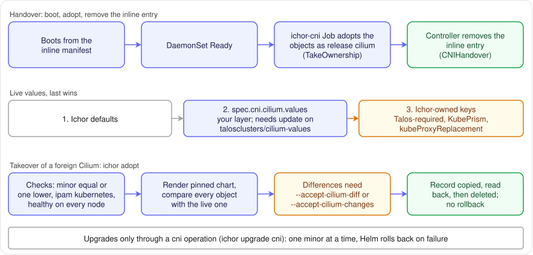

# Cilium

*Cilium is Ichor's own Helm release.*

- **Handover.** Ichor stops rendering the inline entry once the hand-over is done, so the Helm release is the only source of Cilium. The `ichor-cni` Job (installer image, hidden `ichor cni helm apply`, host network via KubePrism) needs cluster-admin-equivalent rights, so the controller does not run Helm itself.
- **Values** are edited in the UI or with `ichor get|apply|edit|diff cni-values`, validated by one function in the webhook, backend and controller, and applied by the Job. Changing the layer needs `update` on `talosclusters/cilium-values`, held by `ichor-admin` only (the chart can run privileged pods on every node). The `*.secretsNamespace.name` keys are pinned to `cilium-secrets`. The operator runs one replica on a one-node cluster and two otherwise; a Helm Job failing with the same values is retried with a growing backoff.
- **Upgrades.** A new Ichor release carries new pinned charts. Cilium upgrades only when a `cni` operation is started (`ichor upgrade cni`, or the UI), one minor at a time, rolled back by Helm on failure. The cluster rollout runs it last.

## Takeover

`ichor adopt` can take over a Cilium installed by someone else (Helm release, Cilium CLI, Talos inline manifest, applied `helm template`).

- **Refused up front:** a live minor that is not the pinned minor or one lower; `ipam.mode` other than `kubernetes`; Cilium or KubePrism unhealthy on any node. The tunnel protocol is carried over.
- **Values** come from the newest Helm release record; with none, Ichor's defaults are used and the diff shows what is missing.
- **Diff.** Ichor renders the pinned chart with the effective values and compares every object. A difference needs `--accept-cilium-diff`; a change to an Ichor-owned key on the running data plane needs `--accept-cilium-changes`. IPAM and the tunnel protocol are never accepted.
- **Apply.** The Job runs `cilium.Apply` with `--takeover` (`TakeOwnership`). When the rollout is Ready the foreign release record Secrets are copied to `ichor-cilium-prior-release` in `ichor-system`, read back byte for byte, then deleted (`RemoveForeignReleaseRecord`; never `helm uninstall`). An inline manifest entry is found by content, recorded in `status.cni.takenOverInlineManifest`, and removed only after `CNIHandover` is true.
- There is no rollback of an adoption.
