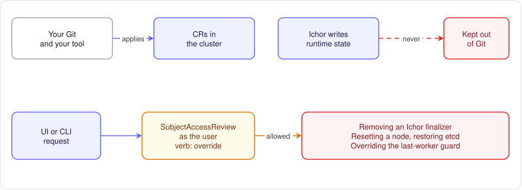

# Git, override and recovery

*Git holds your CRs, never what Ichor writes at runtime. The override verb guards the dangerous operations.*

- **Git.** Keep CRs in your own Git and apply them with any tool; Ichor writes no repository skeleton. Keep out of Git whatever Ichor writes at runtime: `TalosOperation`s, unapproved machines, and the labels and annotations on Nodes and on the storage system's node objects. Otherwise your tool and Ichor fight.
- **Override** is the RBAC verb `override`, checked with a SubjectAccessReview made as the user. It guards removing an Ichor finalizer from a deleting object, resetting a node, restoring etcd and overriding the last-worker guard.
- **Upgrades** always run through the installer Job. Its CRD check lets only the retired fields disappear and refuses every other removed field.
- **Recovery without a controller:** `ichor upgrade ichor VERSION --local` (no ichor-ui) and `ichor restore cluster`.
