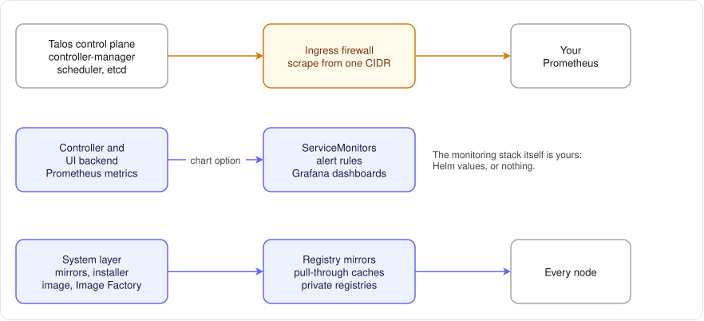

# Monitoring and registry mirrors

*Ichor exposes metrics and pushes mirrors; the monitoring stack is yours.*

**Monitoring.** Ichor installs no monitoring stack.

- It can expose the control-plane metrics Talos binds locally (controller-manager, scheduler, etcd) and restrict scraping to a CIDR with Talos's ingress firewall.
- The controller and UI backend export Prometheus metrics. ServiceMonitors, alert rules and Grafana dashboards are an optional part of the chart.

**Registry mirrors** are optional and off by default.

- `spec.registries` is pushed to every node through the system layer. It serves pull-through caches and private registries, not air-gapped installs.
- `spec.imageFactoryURL` names a self-hosted Image Factory: an https URL with a host, an optional port and no path. Unset means `https://factory.talos.dev`.
- Ichor does not check that a mirror is reachable before an upgrade.
