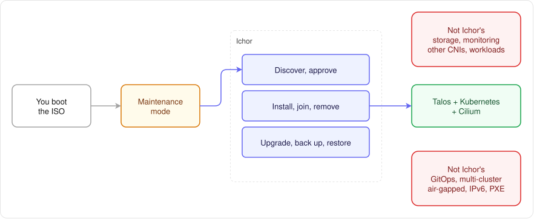

# Motivation

`talosctl` suits one person and a handful of nodes. It strains when machine configs live in a directory of YAML, when several people must see what is applied where, and when upgrades are sequenced by hand. Putting the configuration in the Kubernetes API gives RBAC, audit, webhooks and a place for a UI, with no new control plane.

*What Ichor does, and where it stops.*

## Goals

- Declarative machine configuration as Kubernetes resources, with drift detection and an effective-config view per node.
- Node lifecycle: discover a node in maintenance mode, approve it in a UI, install, join, remove it safely (drain, etcd membership, reset).
- Rolling Talos and Kubernetes upgrades, with the cluster lock, etcd quorum and storage evacuation handled.
- etcd backup to S3-compatible storage; recovery from only the secrets bundle and a snapshot.
- Cilium bootstrap for a new cluster, with no Git repository.
- CLI and UI parity.

## Non-goals

- Getting machines to maintenance mode: boot the ISO however you like.
- Storage, monitoring, any CNI other than Cilium. The storage system's own controller keeps volumes, replicas and disk state.
- Workloads. Ichor manages Talos, Kubernetes and Cilium. It does not sync its own resources from Git, detect GitOps tools, open pull requests or refuse a write because a tool tracks the resource.
- Multi-cluster management: one Ichor, one cluster.
- Air-gapped installs. Registry mirrors exist only for pull-through caches and private registries.
- IPv6 and PXE provisioning: later, maybe.
