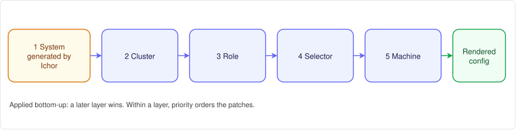

# Patch layers

*Patches apply bottom-up; a later layer wins.*

| Layer | Holds |
| --- | --- |
| 1 System (generated by Ichor) | CNI settings, kube-proxy, KubePrism, volume configs from disk roles, kernel modules and sysctls for storage presets, metrics exposure, control-plane taints |
| 2 Cluster, 3 Role, 4 Selector | your patches |
| 5 Machine | per-node values and machine-specific patches |

Within a layer, `priority` orders the patches. The effective-config view in the UI shows which layer each value came from.
