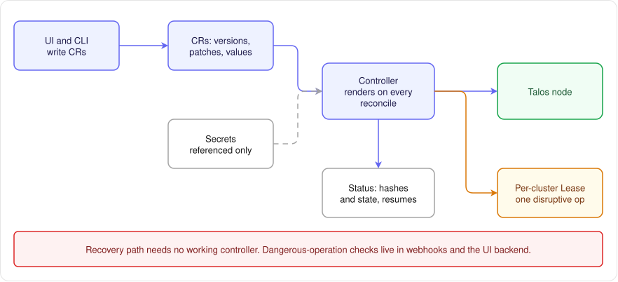

# Principles

*CRs are ingredients; the controller renders and applies, one disruptive operation at a time.*

1. Machine config is never stored in a CR. CRs hold the ingredients (versions, patches, per-node values); the controller renders on every reconcile.
2. Secrets are referenced, never embedded.
3. Status holds hashes and state, never rendered config.
4. The Talos version contract is pinned in the CR, so a library bump cannot silently change what is applied.
5. The controller never writes `spec`, so it never fights the tool the user keeps CRs in. Three narrow writers are the exceptions. Each is a separate ServiceAccount the controller impersonates, limited by the webhook, so the audit log shows the write as that user:

   | ServiceAccount | Writes |
   | --- | --- |
   | `ichor-auto-patch` (off by default) | a newer patch of the running minor, to the two version fields |
   | `ichor-storage-extensions` (`patch` on `talosclusters` only) | `spec.schematic.id`, from unset or the stock schematic to a schematic with the extensions the storage preset needs; the upgrade that applies it waits for approval (`ichor approve operation`); ADR 0173 |
   | `ichor-consent-sweep` (`patch` on `talosclusters` only) | removes `ichor.maesh.dev/confirm-kube-proxy-switch` once no switch needs it, and nothing else; ADR 0066 |

6. Disruptive operations (upgrades, reboots, CA rotation, topology changes) take a per-cluster Lease: one at a time.
7. Progress lives in status and resumes idempotently. A step that fails on a transient error is retried automatically, five times with backoff from 1 to 16 minutes (`status.autoRetry`; ADR 0174). Exception: a live etcd restore rolls the API back, so its marker lives in the backup storage.
8. CLI and UI are equivalent. The only CLI-only operations are those that happen before a cluster exists.
9. A recovery path always exists that needs no working controller.
10. Dangerous-operation checks live in shared code, enforced by the UI backend and by webhooks, never only in the frontend.
