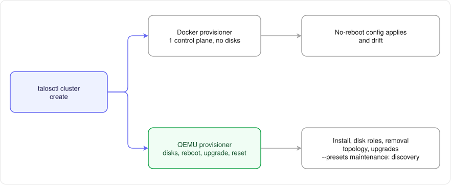

# Testing

*Which provisioner runs which scenarios.*

e2e runs against throwaway clusters from `talosctl cluster create`, from the first phase on.

- **QEMU is required for most of it.** The Docker provisioner is capped at one control plane, has no disks, and its own documentation excludes the `upgrade` and `reset` APIs. Docker stays for config applies that need no reboot, and drift.
- **Discovery** needs a node that is up but unconfigured: `--presets maintenance`.
- **Scenarios** follow the features: bootstrap and join; patches with and without reboot; drift; removal and replacement; topology changes, including the even-count rejection; Cilium bootstrap, adoption and values edits; prune protection; storage preparation and evacuation; all three upgrade kinds with rollback; backup, restore and full-loss recovery; certificate rotation.
- **Each scenario** runs through both the CLI and the backend API.
- **Chaos cases** kill the controller or reboot a node mid-rollout and check that status-driven resumption works.
- **Sets.** The short e2e set (`make test-e2e`) is the only one wired to make. The hardware cases in `test/e2e/foreign/` run one at a time by hand, as that package's doc comment describes.
- **Repository gates** run with `make test`, among them `TestNoTrackedExecutables` (no tracked executable files), `legacycheck` (the word "legacy" for the `v1alpha1` document) and `diagramlabels`.
