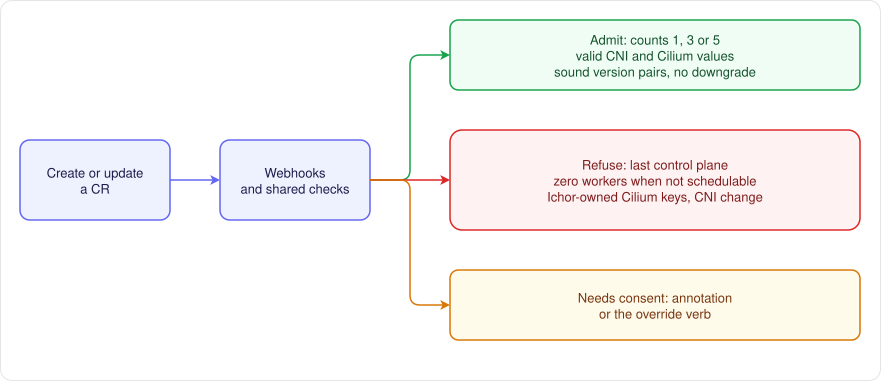

# Validation

*A write is admitted, refused, or held until the person consents.*

Webhooks enforce, among other things:

| Area | Rule |
| --- | --- |
| Control planes | count is 1, 3 or 5; never approve more than configured; never delete the last one |
| Workers | no `schedulable: false` with zero workers |
| CNI | preset is `cilium`, or `unmanaged` on an object carrying `ichor.maesh.dev/adopted: "true"`; a removed preset or `spec.cni.custom` is refused; `spec.cni` and `spec.network` cannot be removed; Cilium values are validated and may not set Ichor-owned keys |
| kube-proxy | mode changes only with the `ichor.maesh.dev/confirm-kube-proxy-switch` annotation |
| VIP | a `vip` endpoint that an approved control plane with static addresses cannot hold is refused: outside its subnets, or one of its own addresses. A DHCP machine is not checked |
| Image Factory | `spec.imageFactoryURL` must be an https URL with a host and an optional port, no path, query or credentials |
| Disk roles | mutable after install (ADR 0092) |
| Deletion | `TalosCluster` and `TalosMachine` need `ichor.maesh.dev/allow-delete: "true"`, so a prune by your own tooling cannot cascade into node resets |
| Override verb | removing an Ichor finalizer, resetting a node, restoring etcd |
| Versions | Talos/Kubernetes pairs and upgrade paths are checked; an admitted version is never a downgrade and never a pair the compatibility table refuses |
