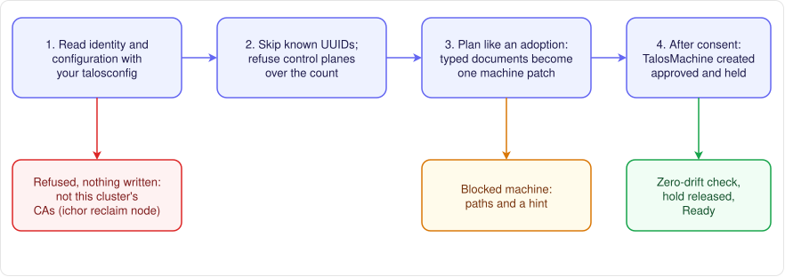

# Add a machine that is already in the cluster

For a machine that runs a configuration signed by your cluster's CAs but has no `TalosMachine`: a node you added with your own `talosctl apply-config`, or whose `TalosMachine` you deleted by hand. Discovery cannot find it (it is not in maintenance mode) and it must not be reset (that would wipe an etcd member or a joined kubelet). `ichor adopt --add-machine` registers it with an adoption's safety.



*What `--add-machine` does, in order.*

```sh
ichor create credentials prod                      # a talosconfig for the cluster, if you have none
ichor adopt --cluster prod --add-machine 10.0.0.21 --talosconfig ./talosconfig.ichor --plan
ichor adopt --cluster prod --add-machine 10.0.0.21 --talosconfig ./talosconfig.ichor
```

A machine removed with `ichor delete node` (or the UI "Remove node") is wiped instead and, once it answers in maintenance mode, shows up as a new pending machine. With `--reboot` it answers by itself and the removal waits up to five minutes for that, then a Warning Event says the wipe is not confirmed. After the default power off the removal does not wait: power the machine on.

## Rules

- `--add-machine` is repeatable and needs Talos v1.12 or later on the machine.
- The `TalosCluster` must exist in the namespace given by `-n` (default `ichor-system`). Unlike a full adoption, this does not check that `-n` is the controller's namespace.
- The secrets bundle is read from the cluster's own Secret (your kubeconfig must be allowed to read it), unless you give `--secrets-bundle` or `--recover-secrets`. Refused while a CA rotation is under way.
- Refused here: `--node`, `--cni-unmanaged`, `--tunnel`, `--cilium-values`, `--accept-cilium-*`, `--require-ichor`, `--version-contract`.
- `--plan` writes nothing.

## Steps

1. The machine's configuration must name this cluster's ID and Talos API CA. Otherwise it is refused with nothing written, and the message names `ichor reclaim node`.
2. A machine whose UUID already has a `TalosMachine` is skipped. A control plane beyond `spec.controlPlane.count` is refused (raise the count first: 1, 3 or 5).
3. Typed documents (sysctl, kernel modules, install disk, image) become one machine patch, Ichor-owned settings are listed, and anything else blocks that machine with the paths and a hint. Role and install disk come from the machine.
4. After consent the `TalosMachine` is created approved and held; the hold is released only after a live zero-drift check, and the CLI waits for Ready. The controller applies the first render; the CLI applies nothing. No CA rotation advice is printed.

Not covered: the UI has no button for this yet. Discovery still reports such an address as "already configured"; the `!` line of `ichor discovery add` names both commands.
