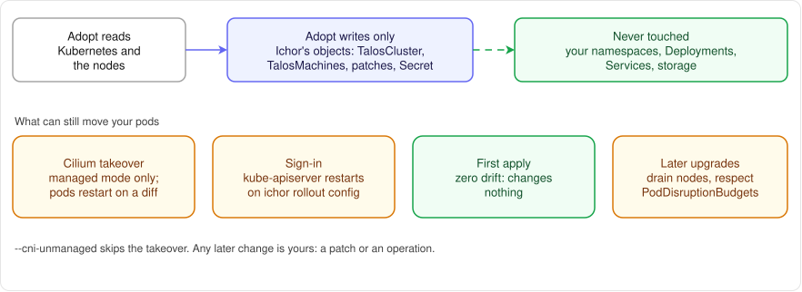

# After adoption

*Adopt writes only Ichor's own objects; your workloads move only through these four.*

Adopt prints advice, and the UI shows it on the cluster page until you dismiss
it: the previous administrators' Talos and Kubernetes client certificates, and
the CA keys held by whoever created the cluster, stay valid. Consider
`ichor rotate ca`. Nothing starts a rotation for you.

| What can move pods | When |
|---|---|
| Cilium takeover (managed mode only) | Restarts the Cilium pods on every node when the rendered chart differs from what runs. The plan announces it and the diff gate shows it. `--cni-unmanaged` skips it. |
| Sign-in | Marks every control plane `APIServerRestartRequired`; kube-apiserver restarts only on `ichor rollout config` (see [Sign-in](sign-in.md)). |
| First apply on each machine | Happens only when the live configuration equals what Ichor renders, so it changes nothing. |
| Later upgrades | Drain nodes as usual and respect PodDisruptionBudgets. |

Adopt installs no GitOps tool, storage or monitoring.

The cluster may run another Talos or Kubernetes version than your `ichor`
binary's release set. Adopt takes the running versions as they are (floor: Talos
v1.14 for the version contract); an unknown version is refused, an incompatible
pair is a warning.
