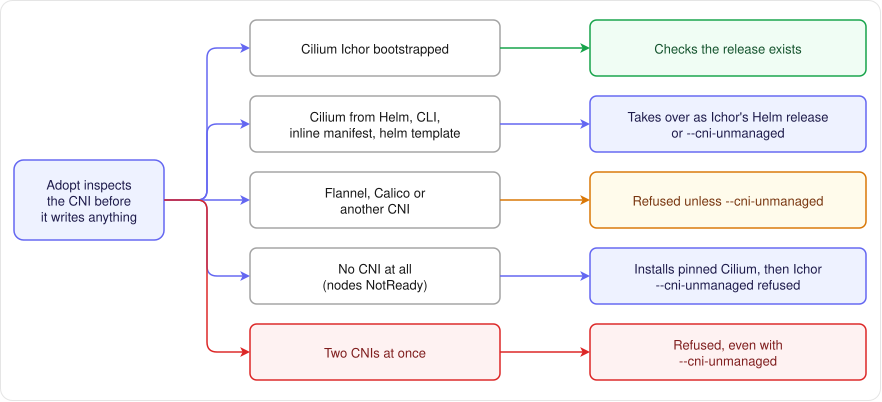

# The CNI

## Step 3: the CNI

Adopt inspects the CNI before it writes anything. The mode is never chosen for you.

*What adopt does for each CNI it finds.*

| Found | Notes |
|---|---|
| Cilium from Helm, the Cilium CLI, a Talos inline manifest or an applied `helm template` | Taken over (below), or left alone with `--cni-unmanaged`. |
| Flannel, Calico or another CNI | The refusal names the CNI and says Ichor does not migrate one: see [Moving from flannel](moving-from-flannel.md). |
| No CNI (`cni.name: none`, no CNI workload, every node NotReady "cni plugin not initialized") | Managed Cilium is installed first. `--cni-unmanaged` is refused. |
| `cni.name: none` with a CNI you applied by hand | Adopted unmanaged (`talosCNI: none`), CNI left as is. |

Adopt records the cluster endpoint as type `node`, never `vip`: it does not claim an address it did not configure.

## `--cni-unmanaged`

- Ichor does not install, upgrade or configure the CNI. The Cilium commands (`get`, `edit`, `apply` and `diff cni-values`, `upgrade cni`, `set kube-proxy`) and `cni` operations are refused.
- Still works: Talos and Kubernetes upgrades, CA rotation, config rollout, etcd backup, node add and remove.
- Permanent: `spec.cni.preset` is immutable, so managed means a new cluster.
- Ichor's network policies are applied only if Cilium is detected; otherwise `ichor-system` is not isolated by Ichor.

## A cluster with no CNI

- Nodes are NotReady, so no pod runs. Adopt installs the Cilium pinned in your `ichor` binary as Ichor's own Helm release (`cilium` in `kube-system`, records in `ichor-system`) before Ichor, and waits up to 10 minutes for Ready nodes.
- Preconditions, checked read-only before the plan asks for consent: Talos v1.14 or later, KubePrism on port 7445 on every node (Talos's default), a pod CIDR on every node.
- Nothing is detected from an existing Cilium. `--tunnel vxlan|geneve` picks the tunnel (immutable). Kube-proxy is read from Talos: enabled gives `kubeProxyReplacement=false`, disabled `true`.
- `--cilium-values FILE` merges your values over Ichor's defaults. Ichor-owned keys are refused; writing values needs `update` on `talosclusters/cilium-values` (`ichor-admin` has it).
- There is no `ichor-cni` Job and no inline manifest to remove, so hand-over completes at once. If adopt stops half-way, run it again.

## Taking over Cilium

- The live Cilium minor equals the chart's minor in your Ichor build, or is one lower; otherwise adopt refuses (upgrade it with the tool that installed it).
- `ipam.mode` must be `kubernetes`; `cluster-pool` is refused.
- Adopt renders the pinned chart and compares each object with the live one. Differences are printed per object and path and need `--accept-cilium-diff`.
- An Ichor-owned setting (for example `kubeProxyReplacement`) that would change on the running data plane needs `--accept-cilium-changes`. The IPAM mode and tunnel protocol are never accepted.
- Cilium must be healthy before anything is written: the `cilium` DaemonSet Ready on every node it is scheduled to, the operator Deployment Ready, and KubePrism answering on `127.0.0.1:7445` on every node (Talos `KubePrismStatuses`, read through each node's Talos API; a node that cannot be asked counts as not answering). The check runs with `--plan`, before consent; a failure refuses with nothing written. The takeover restarts the agents, and the `ichor-cni` Job reaches the API through KubePrism meanwhile.
- Helm values come from the newest release record. A Cilium from a Talos inline manifest (`helm template`) has none: give `--cilium-values FILE` (the file you passed to `helm template`). It is checked like `spec.cni.cilium.values`, used by the diff gate, and kept by the new `TalosCluster`. Without it Ichor's defaults are used, the diff lists every value you set, and `--accept-cilium-diff` replaces them with defaults. With a release record the flag is refused. It works only for a cluster adopt creates.
- After the rollout is Ready, the `ichor-cni` Job copies the foreign Helm release Secrets into `ichor-cilium-prior-release` in `ichor-system`, reads them back, then deletes the originals. The plan says so before consent. `helm rollback` of the old release is then impossible; nothing is uninstalled.

> [!WARNING]
> There is no rollback of an adoption.
