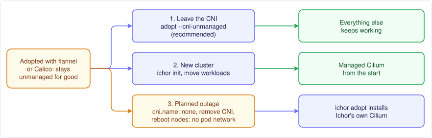

# Moving from flannel (or Calico) to a Cilium Ichor manages

Ichor does not migrate a CNI, and `spec.cni.preset` is immutable, so an unmanaged adoption stays unmanaged.

*The options, from the default recommendation to the most disruptive.*

1. **Leave the CNI.** `--cni-unmanaged`; everything else keeps working.
2. **A new cluster** with `ichor init`; move the workloads.
3. **A planned outage.** Adopt installs its own Cilium on a cluster with no CNI. To get there yourself: set `cluster.network.cni.name: none` in the machine configuration, remove the old CNI workload, reboot the nodes until every one is NotReady. Pods have no network from the first step until Cilium is up. Then run `ichor adopt`. Ichor does not run the removal: try it on a copy first.

Cilium's documented live migration from flannel does not fit: it ends on `ipam.mode: cluster-pool`, which Ichor refuses to take over (changing IPAM renumbers pods) and does not use (Ichor runs `ipam.mode: kubernetes`).
