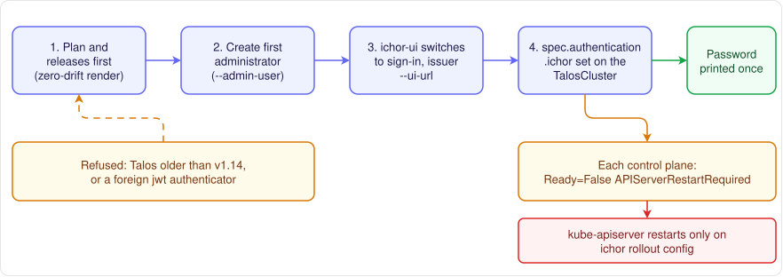

# Sign-in

Sign-in is on by default in adopt, as in `ichor init`. It cannot be turned off: `--allow-unauthenticated` was removed and adopt refuses it.

*Sign-in comes after the zero-drift first render; the restart waits for you.*

- Administrator: `--admin-user` (default `admin`). The generated password is printed once, as the last thing before `Next` (or when adopt stops early), and must be changed at the first sign-in.
- Issuer: `--ui-url` (default `https://localhost:8443`, where `ichor ui` serves ichor-ui).
- Needs Talos v1.14 or later; an older cluster is refused with nothing written.

> [!WARNING]
> The consent prompt names the cost. `spec.authentication.ichor` adds an authenticator to every control plane's `KubeAuthenticationConfig`, so each reports `Ready=False APIServerRestartRequired`. kube-apiserver restarts, one control plane at a time, only when you run `ichor rollout config` (or Apply in the Overview page's attention list); until then it keeps running as is. With a single control plane the Kubernetes API is down while it restarts. Choose the moment.

## An https address of your own

Adopt takes the flags `ichor init` has: `--ui-url`, `--ui-tls-secret` or `--ui-tls-cert` with `--ui-tls-key`, `--kube-api-server-url`, `--kube-api-tls-server-name` (see [Users and login](../users-and-login.md)). They are checked before anything is written, and refused where adopt would not apply them: a Helm-managed Ichor (set the chart values `ichorUI.tls.secretName`, `ichorUI.users.kubeAPIServerURL`, `ichorUI.users.kubeAPITLSServerName`) and an ichor-ui that already has sign-in on.

## Re-running

If adopt stops after creating the administrator, run it again: it sets what is missing and creates no second administrator. A cluster with its own jwt authenticator is refused (move the identity provider into `spec.authentication.external` first); the issuer Ichor set is not counted as foreign on a second adopt or an add-machine.
