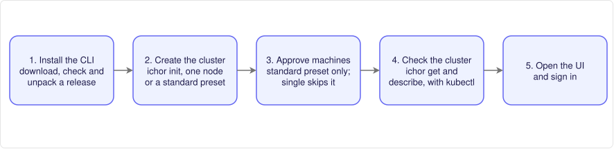

# Getting started

This guide takes you from a downloaded `ichor` CLI to a running one-node
cluster managed by Ichor.

> [!NOTE]
> For an existing Talos cluster, use [Adopt a running cluster](adopt-a-cluster.md)
> instead. To build the CLI and the images yourself, see
> [Build from source](../development/build-from-source.md).

## Before you begin

| You need | Why |
| --- | --- |
| One machine (virtual or bare metal) booted from a Talos ISO into maintenance mode, reachable on port 50000 from your workstation. This guide uses `192.168.1.50`. At least 2 GiB of memory for a control plane. | `ichor init` configures the machine over the Talos API. |
| Network access from the machine to `ghcr.io` (Ichor's images), the Talos installer image and Cilium's images. | Air-gapped installs are out of scope. |
| A Linux or macOS workstation (amd64 or arm64) that reaches port 50000 on the machine and, once the node is up, port 6443 on the cluster's endpoint address. | `ichor init` installs Ichor through that address, and so do `kubectl` and the later steps. |
| [`kubectl`](https://kubernetes.io/docs/tasks/tools/) on the workstation. | The CLI does not bundle it. Steps 3 and 4 use it. |

> [!IMPORTANT]
> Boot an ISO of Talos v1.14.5 or newer. `ichor init` reads the node's version
> and refuses an older one before it writes anything. Ichor does not boot
> machines; get them to maintenance mode by ISO, PXE or whatever you like.

## The steps

*The five steps. The single preset skips step 3.*

1. [Install the CLI](getting-started/install-the-cli.md): download, check and unpack a release.
2. [Create the cluster](getting-started/create-the-cluster.md): run `ichor init --preset single` against the node. Without `--preset` the cluster has three control planes.
3. [Approve machines](getting-started/approve-machines.md): add and approve further nodes.
4. [Check the cluster](getting-started/check-the-cluster.md): read its state with the CLI.
5. [Open the UI and sign in](getting-started/open-the-ui-and-sign-in.md): reach ichor-ui.
