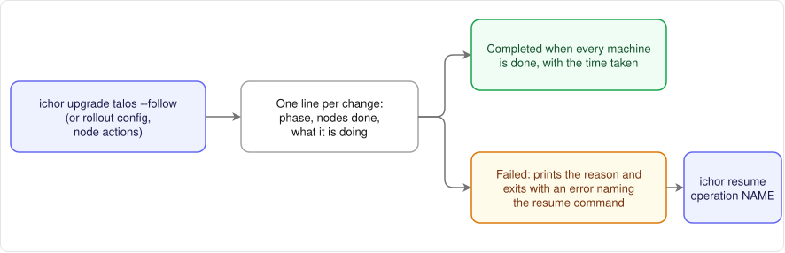

# 4. Check the cluster

```sh
export KUBECONFIG=~/.ichor/clusters/demo/kubeconfig
ichor get cluster demo
ichor describe cluster demo
ichor get nodes --cluster demo
ichor version
kubectl get nodes
```

```console
$ ichor get cluster demo
demo · ichor-system
  Talos        v1.14.5
  Kubernetes   v1.36.6
  Cilium       1.20.4
  Endpoint     192.168.1.50 (node)
  Health       ✓ ready

$ ichor get nodes --cluster demo
NAME      ROLE           APPROVAL  READY  ENDPOINT            KUBERNETES NODE  AGE
fa70962a  control-plane  approved  ✓      192.168.1.50:50000  demo-cp          5m

$ ichor version
ichor        v{{version}}
installed    v{{version}}
new installs Talos v1.14.5 · Kubernetes v1.36.6 · Cilium 1.20.4 (contract v1.14)
```

`get cluster` prints versions, endpoint and health; `describe cluster` adds the
network, CNI, control plane, certificate expiry and every condition (✓, `!`, ✗ or …).
Every machine should be Ready (✓), and `ichor version` should show the release you
installed for both CLI and installed Ichor. With sign-in on, these commands print
the sign-in line from [step 3](approve-machines.md) on stderr; the output below omits it.

> [!TIP]
> Add `-o yaml` or `-o json` to any command for the full response, with long
> machine names whole. Colour appears only on a terminal; `NO_COLOR` turns it off.

`ichor get operations` shows each operation's phase and activity; `ichor describe
operation NAME` adds each machine's state. `--follow` (on `upgrade`, `rollout
config` and the node actions) and `describe operation NAME --watch` keep one
live line and end it with the duration; in a pipe or CI log they print a line per
change:

```console
$ ichor get operations
NAME                 KIND    PHASE         TARGET  MESSAGE                       AGE
upgrade-talos-x7k2p  talos   … InProgress  demo    upgrading talos-cp2 (2 of 3)  12m
config-r2d9m         config  ✓ Completed   demo    -                             3d
$ ichor upgrade talos --follow --yes
Upgrade Talos v1.14.3 → v1.14.5
operation upgrade-talos-x7k2p · cluster demo
… talos — InProgress · 0/3 nodes · upgrading talos-cp1
… talos — InProgress · 1/3 nodes · upgrading talos-cp2
✓ talos — Completed (11m52s)
```



*Following an operation to its end.*

A failed step ends with ✗ Failed, the reason, and an error naming `ichor resume
operation NAME`. A step that failed on a transient error is first retried by the
controller itself, with backoff, up to five times (`status.autoRetry` shows the
count and the next retry); an operation that waits for approval is started with
`ichor approve operation NAME`. `ichor upgrade talos --list` (and `kubernetes`)
prints the versions on offer.
