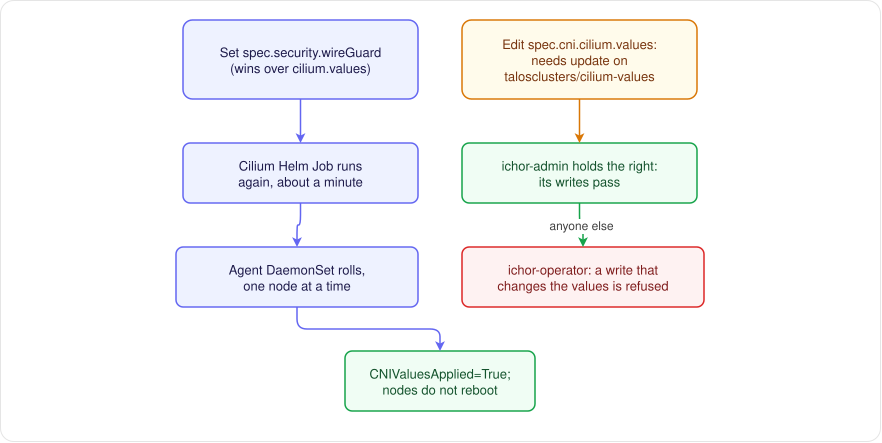

# Cilium: WireGuard and Helm values



*A typed option or a Helm value changes the agents; only admins may write the values.*

## WireGuard encryption

```yaml
spec:
  security:
    wireGuard: {enabled: true, nodeEncryption: false}
```

- Sets `encryption.enabled`, `encryption.type=wireguard` and `encryption.nodeEncryption` in the managed Cilium Helm values (Cilium 1.20). It wins over a conflicting `encryption.*` in `spec.cni.cilium.values`.
- Agents read encryption only at start, so Ichor sets the chart's `rollOutCiliumPods`: the DaemonSet rolls one node at a time. Nodes do not reboot.
- `CNIValuesApplied` turns True when the Job is done and the DaemonSet has rolled out. Check with `cilium-dbg encrypt status`.
- Pod traffic between nodes is encrypted once both ends have switched; connections reset briefly as each agent flips. The tunnel MTU shrinks.
- With the firewall on, UDP 51871 opens between nodes.
- Strict mode (`encryption.strictMode`) is not modelled: set it through `spec.cni.cilium.values` after every agent reports encryption.

## Cilium Helm values

`spec.cni.cilium.values` feeds a Helm Job that can create privileged,
host-network pods with host paths on every node (`extraContainers`,
`extraHostPathMounts`, image overrides).

> [!WARNING]
> A user who could write the values could become root on the nodes.

So changing them (UI, `ichor apply cni-values`, `ichor edit cni-values`,
`ichor adopt --cilium-values`, `kubectl`) needs the verb `update` on
`talosclusters/cilium-values`. Only `ichor-admin` holds it. `ichor-operator`
can edit everything else and start a Cilium upgrade, but a write that changes
the values is refused; one that leaves them alone is not. The webhook checks the
requesting user, so a hand-written CR obeys it too.

Ichor pins the five `*.secretsNamespace.name` values (`ingressController`,
`gatewayAPI`, `envoyConfig`, `bgpControlPlane`, `tls`) to `cilium-secrets` and
refuses them as "set by Ichor" if you set them. Put BGP authentication Secrets
in `cilium-secrets`, not the chart's default `kube-system`.
