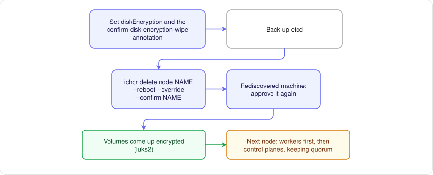

# Disk encryption



*Talos encrypts a volume only when it creates it, so every existing node is wiped and rejoined, one at a time.*

```yaml
spec:
  security:
    diskEncryption: {type: tpm, requireSecureBoot: true}   # or nodeID, or kms + kmsEndpoint
```

Renders `VolumeConfig` documents for STATE and EPHEMERAL with a LUKS2 key slot 0
(Talos v1.14), EPHEMERAL's key locked to STATE. Key types:

- `tpm`: sealed in the TPM 2.0, bound to PCR 7. `requireSecureBoot` makes enrolment fail unless SecureBoot is on; without it the key protects no boot chain.
- `nodeID`: derived from the node UUID; protects only against a removed disk.
- `kms`: a KMS server seals and unseals the key. `kmsEndpoint` must be `https://`; Ichor refuses other schemes.

Static passphrases are not offered (they would sit in the machine config).

## Nodes without a TPM

Ichor keeps no hardware inventory and does not check for a TPM. Talos refuses
to enrol a TPM key without one, so the node installs, reboots and stays in
stage `booting` with the STATE volume `failed`. The `Ready` message carries
Talos's error (`... a volume failed: STATE: stat /dev/tpm0: no such file or directory`).

## Existing machines

> [!WARNING]
> Setting this on a cluster with approved machines changes nothing on them
> until each is wiped and rejoined.

The webhook refuses the change unless the `TalosCluster` carries
`ichor.maesh.dev/confirm-disk-encryption-wipe: "true"`. Ichor never wipes a
node for this. Per node:

1. Set the option and the annotation. Back up etcd first.
2. Remove a worker, wait for it to rejoin encrypted; then each control plane in turn, keeping etcd quorum.

### Remove the node

"Reset and add" is for machines of another cluster and refuses one already in
Ichor. For your own node:

```sh
ichor delete node NAME --reboot --override --confirm NAME
```

`NAME` is the TalosMachine name (not the hostname), and `--confirm` repeats it.
Approve the machine again once it is rediscovered. It is Ready a few minutes
after approval, and `talosctl get volumestatus` shows `encryptionProvider: luks2`.

### Pods that block the drain

Bare pods (no controller) block the drain: the machine's `Removal` condition
says `DrainFailed` and names the pod, a Warning Event repeats it, and the drain
retries with growing backoff. Delete the pod (there is no force option; Ichor
never deletes a pod nobody owns). The remove deletes the Kubernetes Node once
it is not Ready.

### Confirming the wipe

| Flag | What confirms the wipe | If it does not |
|---|---|---|
| `--reboot` | The machine answers in maintenance mode with its UUID, within 5 minutes | The removal completes; Warning Event `NodeStillHasClusterCredentials` |
| none | The machine is powered off and cannot answer | The removal completes once the Node is NotReady; Warning Event `WipeNotConfirmedPoweredOff` |

If the Node is still Ready after five minutes, Ichor keeps it, stops counting
its address as a member so discovery finds the wiped machine, and a Warning
Event names `kubectl delete node`.
