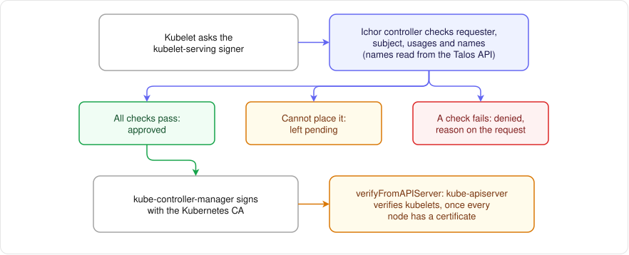

# Kubelet serving certificates



*Ichor's controller is the only approver, and only for its own checks.*

```yaml
spec:
  security:
    kubeletServingCertificates: {enabled: true, verifyFromAPIServer: false}
```

A Talos kubelet serves a self-signed certificate on 10250, which the
kube-apiserver cannot verify (a metrics-server needs `--kubelet-insecure-tls`).
`enabled` renders
`serverTLSBootstrap: true` for every kubelet (the `KubeletConfig` document from
v1.14, `machine.kubelet.extraConfig` before). Each kubelet restarts once.

## How requests are approved

The controller decides only `kubernetes.io/kubelet-serving` requests, only in a
cluster that enabled the option. It approves when all hold:

- the requester is that node's kubelet (`system:node:<name>`, group `system:nodes`);
- the subject is exactly `CN=system:node:<name>, O=system:nodes`;
- the usages are `digital signature` and `server auth` (`key encipherment` allowed), with no extension but the names;
- every DNS name and IP belongs to that node, read over the authenticated Talos API (the `--node-ip` addresses, node name and hostname), not from the Node object.

It denies a failing request with the reason on the request (`kubectl describe
csr`) and a Warning Event on the TalosCluster. It leaves a request pending
when it cannot place it (the name is not one of the cluster's machines, or the
node cannot be read now); you can approve that yourself.

Until a request is signed the kubelet keeps its old certificate, so switching
on cannot take a node down. Renewals are approved the same way; after a
Kubernetes CA rotation the kubelet asks again.

`kubectl get csr` shows the approver `IchorKubeletServing`. The cluster
condition `KubeletServingCertificates` is True when every machine has a
certificate, and otherwise names the waiting ones; each machine's
`status.kubeletServingCertificate` has the request and expiry.

## verifyFromAPIServer

Sets `--kubelet-certificate-authority` on the kube-apiserver (the Kubernetes
CA), so it refuses a kubelet whose certificate that CA did not sign. Ichor
renders the flag only once `KubeletServingCertificates` is True, then records
`KubeletServingVerified`, which stays, so a node that joins later does not take
it away. Turning `verifyFromAPIServer` or `enabled` off removes the flag.
Applying it restarts the kube-apiserver on each control plane, one at a time,
with no node reboot.

A metrics-server you run needs no `--kubelet-insecure-tls` once the option is
on. Ichor installs none.

## Check it

```sh
kubectl get csr                              # Approved,Issued, requestor system:node:<name>
kubectl get talosmachine -o yaml | grep -A4 kubeletServingCertificate
kubectl get talosclusters -o yaml | grep -B1 -A3 KubeletServing
kubectl logs -n kube-system <a pod on another node>   # works with verifyFromAPIServer on
openssl s_client -connect <node-ip>:10250 </dev/null 2>/dev/null | openssl x509 -noout -issuer -ext subjectAltName
```
