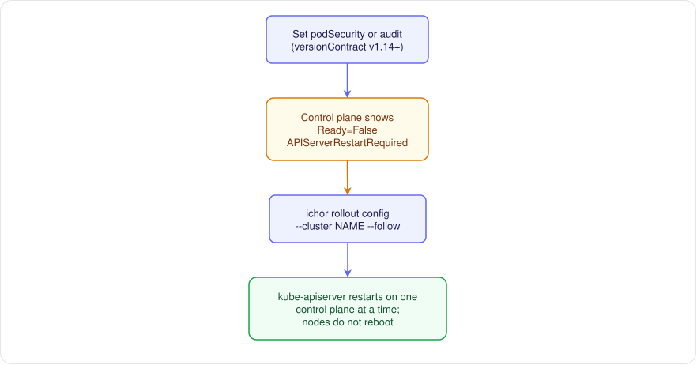

# Pods and the API server



*Nothing restarts until you run the rollout.*

## Pod Security and audit

```yaml
spec:
  security:
    podSecurity: {enforce: restricted, exemptNamespaces: [rook-ceph]}
    audit: {policy: rbacChanges}
```

- Both need `versionContract` v1.14 or later; on an older contract Ichor refuses the option rather than raising the contract.
- Run `ichor rollout config --cluster NAME --follow` (or start the rollout on the cluster page). With one control plane the API is down for about a minute; the whole operation takes a few minutes.
- `podSecurity` changes only the levels you set (`enforce`, `audit`, `warn`; Talos defaults are baseline, restricted, restricted) and adds `exemptNamespaces` to `kube-system`, which stays exempt.
- Existing pods are not evicted; new and updated pods that break `enforce` are rejected. Namespaces with privileged workloads (storage, CNI add-ons) need an exemption.

`audit.policy` presets (none logs Secrets, ConfigMaps, service account tokens
or token reviews above Metadata):

| Preset | Records |
|---|---|
| `metadata` | Who did what, without bodies (Talos's default) |
| `rbacChanges` | `metadata`, plus request and response of role and binding changes |
| `writes` | `metadata`, plus the request body of every change |

Ichor does not change where Talos writes the audit log or ship it anywhere.

## Talos API access from Kubernetes pods

> [!WARNING]
> `machine.features.kubernetesTalosAPIAccess` in a `Config` patch with `os:admin` in `allowedRoles` hands a Talos administrator to every pod in the allowed namespaces.

That is your choice, so the `TalosConfigPatch` webhook admits it and only
warns, naming the roles and namespaces (stronger wording for `os:admin`).
Prefer `os:reader`. Talos allows the feature on control planes only, so Ichor
renders it there and leaves it out of workers, whatever the patch's layer.
