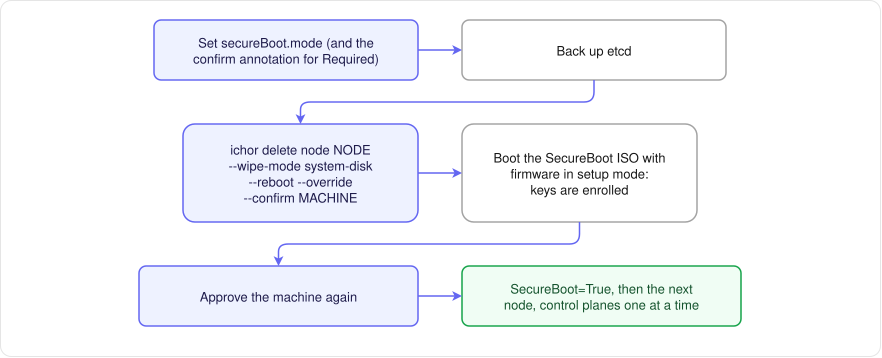

# SecureBoot, UKI and kernel lockdown



*Changing the mode never touches an installed node; each one is wiped and reinstalled in turn.*

```yaml
spec:
  security:
    secureBoot: {mode: Preferred}      # Off (default), Preferred or Required
    kernelLockdown: integrity          # or confidentiality; checked, not rendered
```

Talos (v1.14) boots a signed Unified Kernel Image (UKI), so the firmware
verifies kernel, initramfs and command line. It needs UEFI and a fresh install
from the SecureBoot images. Image Factory (`spec.imageFactoryURL`, default
`factory.talos.dev`) serves the installer as
`metal-installer-secureboot/<schematic>:<version>` and the ISO as
`metal-amd64-secureboot.iso`.

## What the modes do

| Mode | Behaviour |
|---|---|
| `Off` (or unset) | Nothing changes. A node that nevertheless runs SecureBoot is still upgraded with the SecureBoot installer (the stock one writes an unsigned UKI the firmware refuses); its `SecureBoot` condition says the mode and node disagree |
| `Preferred` | Where Ichor picks the installer it picks the SecureBoot variant: a Talos upgrade of a UKI node, or an approval with a disk and no `--install-image` (recorded in `spec.install.image`). Machines without SecureBoot are reported and left alone |
| `Required` | As `Preferred`, plus: a TPM disk key renders `checkSecurebootStatusOnEnroll: true` (unless `requireSecureBoot: false`); the webhook refuses `Required` while an approved machine lacks SecureBoot, unless the cluster carries `ichor.maesh.dev/confirm-secureboot-reinstall: "true"`; and the controller sends no first configuration to a maintenance-mode machine that booted without SecureBoot (`Ready=False`, reason `SecureBootRequired`) |

An installed node without SecureBoot is reported (`SecureBoot=False`), never
reconfigured or wiped.

## Reading the state

`TalosMachine.status.security` holds each node's state (`talosctl get securitystate`);
the `SecureBoot` and `KernelLockdown` conditions sit on each machine and, summarised, on the cluster. `SecureBoot` reasons:
`SecureBootOn`, `SecureBootOff` (UKI, firmware has it disabled), `NotUKI` (GRUB), `ModeOffButSecureBoot`.

## Lockdown

Talos v1.14 SecureBoot images run with `lockdown=integrity` implicitly. The
command line is embedded in the UKI, and `machine.install.extraKernelArgs` is
refused with it, so Ichor cannot render a level. For `confidentiality`, build
an Image Factory schematic with `extraKernelArgs: [lockdown=confidentiality]`
and set `spec.schematic.id` to it. Ichor reports the level in effect in
`status.security.kernelLockdown`: the last `lockdown=` word, else `integrity`
under SecureBoot, else `none`.

## Moving an installed cluster

Ichor never changes an installed node (a GRUB install cannot become UKI, keys
enrol in the firmware, a TPM key is bound to PCR 7). One node at a time, as for
[disk encryption](disk-encryption.md):

1. Set the mode (and the confirm annotation for `Required`).
2. Back up etcd ([Back up etcd to S3](../etcd-backup.md)).
3. Remove the node with a full system-disk wipe (or "The whole system disk" under "What to wipe" in the UI's Remove node dialog):

   ```sh
   ichor delete node NAME --wipe-mode system-disk --reboot --override --confirm NAME
   ```

4. Boot the machine from this cluster's SecureBoot ISO (its schematic and Talos version) with the firmware in setup mode. Keys enrol automatically; on bare metal choose "Enroll Secure Boot keys: auto".
5. Approve it again, and wait for `SecureBoot=True` before the next node. Control planes one at a time, with etcd quorum intact.

> [!WARNING]
> If you build your own images, keep the UKI and PCR signing keys: losing them stops the next UKI booting and the encrypted disks unlocking.

### Why the default wipe is not enough

The default wipe erases only STATE and EPHEMERAL. The boot partition stays, so
a machine with its system disk first in the boot order boots the installed UKI
into maintenance mode and never starts the ISO. `--wipe-mode`:

| Value | Erases |
|---|---|
| `system-partitions` (default) | STATE and EPHEMERAL |
| `system-disk` | The whole system disk, boot and EFI included, so the firmware falls through to the ISO |
| `all` | The same system disk; user disks are left alone |
| `system-disk-and-user-disks` | The system disk and every user disk (only when their data is expendable) |

Keep the ISO attached or first in the boot order before you remove the node.
Ichor's `system-disk` sends Talos's `system-disk` reset mode; its `all` is not
`talosctl reset --wipe-mode all`. After the wipe Ichor looks for the machine
every 15 seconds for 3 minutes.
