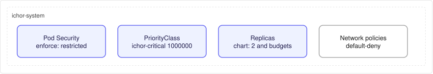

# Hardening the install

*What the install hardens.*

| Measure | Detail |
|---|---|
| Pod Security | The install manifest labels `ichor-system` `pod-security.kubernetes.io/enforce`, `audit` and `warn` = `restricted`; every Ichor pod meets it. The Cilium Helm Job needs the host network and runs in `kube-system`. The chart does not own the namespace, so label it once: `kubectl label namespace ichor-system pod-security.kubernetes.io/enforce=restricted pod-security.kubernetes.io/audit=restricted pod-security.kubernetes.io/warn=restricted` |
| Priority | Both pods use PriorityClass `ichor-critical` (1000000; manifest, or chart `priorityClass.create`): above ordinary workloads, below every `system-*` class, so the controller is evicted last of the user workloads. `system-cluster-critical` is not used: a user namespace may not use it by default. |
| Replicas | The raw manifest runs one replica of each pod and no PodDisruptionBudget (`minAvailable: 1` on one replica would block every drain). The chart runs two and ships the budgets. |
| Network | [Network policies](network-policies.md): default-deny, one allow per flow, no `world` egress left. |

Releases are published only after the verify job passes, from a protected `release` GitHub environment. Maintainers: create it with required reviewers and a `v*` tag ruleset.
