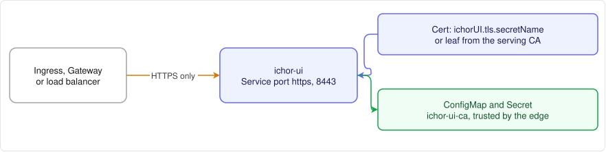

# ichor-ui is HTTPS only

*ichor-ui serves TLS only.*

- ichor-ui serves TLS on 8443, with no plain HTTP; the Service port is named `https`.
- The certificate is yours (`ichorUI.tls.secretName`) or a leaf of the Ichor serving CA, published as the ConfigMap and Secret `ichor-ui-ca` in `ichor-system`.
- Ingress, Gateway or load balancer in front: [Users and login](../users-and-login/expose-ichor-ui.md).

> [!WARNING]
> Re-point a plain-HTTP edge at `https://<ichor-ui>:8443` and trust `ichor-ui-ca` before you upgrade.

- `ichorUI.plaintextPort` was removed; a values file that sets it is ignored.
- An install that already served TLS on 8080 sets `ichorUI.port=8080` to keep its Service and edge.
- The ServiceMonitor verifies against `ichor-ui-ca`; override with `ichorUI.tls.caConfigMap`, `caSecret`, `caKey`. It never skips verification.
