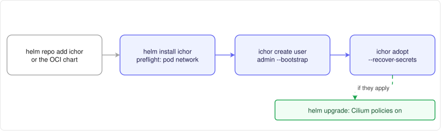

# Install the chart



*Install, sign in, adopt.*

## Where the chart lives

A workflow on each `v*` tag publishes the same signed archive as a Helm repository on the docs site and as an OCI artifact, with the images beside it. Helm is yours to [install](https://helm.sh/docs/intro/install/).

```sh
helm repo add ichor https://ichor.maesh.dev/charts
helm repo update
```

```text
oci://ghcr.io/maeshinshin/charts/ichor
```

- Default images: `ghcr.io/maeshinshin/ichor-controller` and `ichor-ui`, by digest, multi-arch (linux/amd64, linux/arm64). Your own build: [Build from source](../../development/build-from-source.md#install-your-own-chart).
- The chart `version` has no leading `v` (`{{version}}`); `appVersion` and image tags do (`v{{version}}`).

## Install

On a cluster that already has a pod network:

```sh
helm install ichor ichor/ichor --version X.Y.Z \
  --namespace ichor-system --create-namespace \
  --set ichorUI.users.enabled=true --set ichorUI.users.externalURL=https://localhost:8443
ichor create user admin --role admin --generate --bootstrap
ichor adopt --cluster NAME --node ADDR --recover-secrets --recover-from ADDR
```

The OCI form needs no repository: `helm install ichor oci://ghcr.io/maeshinshin/charts/ichor --version X.Y.Z …`.

On a Helm install adopt does not apply the network policies; when they apply it tells you to run:

```sh
helm upgrade ichor ichor/ichor --version X.Y.Z \
  --namespace ichor-system --reuse-values --set networkPolicy.cilium.enabled=true
```

## Values

All values: `dist/chart/values.yaml`.

| Value | Default | Meaning |
|---|---|---|
| `networkPolicy.cilium.enabled` | `null` | `null` renders Ichor's `CiliumNetworkPolicy` objects when the cluster serves that API; `true` renders them regardless (the CRD must exist); `false` renders none. See [Network policies](network-policies.md). |
| `networkPolicy.cilium.metricsNamespaces`, `metricsPodLabels` | `[]`, `{}` | Who may open the controller's metrics port. Empty: nobody. |
| `preflight.cni` | `true` | Refuse to install when every node is NotReady with the network-plugin message. Skipped by `helm template` and `--dry-run`. |
| `installer.enabled` | `false` | Leave off: Helm upgrades a Helm install. |
| `ichorUI.port` | `8443` | HTTPS port of ichor-ui. |
| `ichorUI.tls.secretName` | unset | Your certificate for ichor-ui. Unset: a leaf of the Ichor serving CA. |
| `ichorUI.tls.caConfigMap`, `caSecret`, `caKey` | `ichor-ui-ca`, unset, `ca.crt` | The CA the ServiceMonitor (`prometheus.enabled`) verifies against: the ConfigMap, or the Secret when `caSecret` is set. |
| `rbac.bundleSecret.names` | `[]` | Secrets-bundle Secrets (`<cluster>-secrets` by default) that the Role `ichor-bundle-secret-role` may `get`, for the CLI commands that read a bundle (`ichor adopt`, `create credentials`, `rotate ca`, `export bundle`), bound with a RoleBinding. Empty installs no Role. |
| `settings.readOnly` | `false` | The chart is the only source of runtime settings: `IchorInstallation` settings fields are ignored and the webhook denies writes. |
| `updateCheck.enabled` | `true` | Look for a newer release and show it on the dashboard ([Updates](../settings/updates.md)). `false` stops the requests and their egress rule. |

## The IchorInstallation of a Helm install

The cluster-scoped `IchorInstallation` named `ichor` holds `spec.deployment` (who deploys Ichor) and the runtime settings. On a Helm install `spec.deployment.manager` is `helm` (`installer` or omitted means the installer Job or `ichor init`); the CLI reads it to refuse installer commands and print the Helm command. A field you set wins; an unset one falls back to the chart value. `status.effective` shows each value and its source (`spec` or `deployment`). Full schema: [IchorInstallation](../../reference/crds/ichorinstallation.md); how to change them: [Settings](../settings.md#a-helm-install).

| Field | Changes |
|---|---|
| `spec.deployment.manager` | `installer` (default) or `helm`. |
| `spec.users.tokenTTL`, `refreshLifetime` | Lifetime of issued tokens (1m to 1h) and of refresh tokens (1h to 720h). |
| `spec.defaults.driftPolicy` | `warnOnly` or `autoCorrect`: the drift policy a new `TalosCluster` gets; existing ones are untouched. |
| `spec.updateCheck.enabled` | The newer-release check (chart `updateCheck.enabled`). |
| `spec.autoPatch.enabled`, `components`, `window` | Automatic patch releases: on or off, which of `talos`, `kubernetes`, `cilium`, and the daily UTC `HH:MM-HH:MM` window. See [Automatic patching](../settings/automatic-patching.md). |
| `spec.installerSignature.mode`, `installerDigest`, `installerRepository` | The installer-image check of an installer-run upgrade; unused by `helm upgrade` ([installer image](installer-image.md)). |
