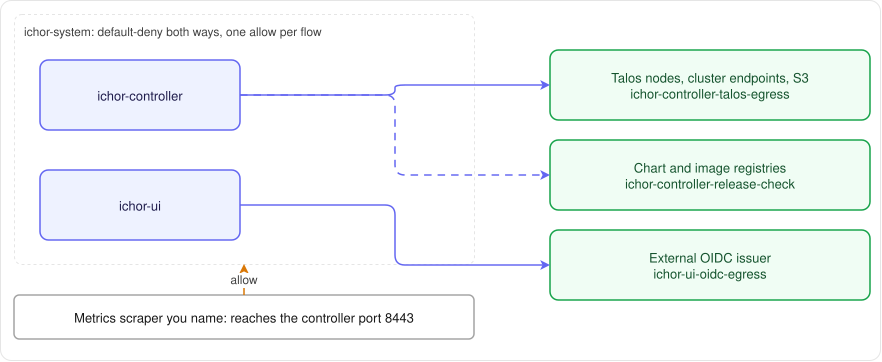

# Network policies

On a Cilium cluster, `ichor-system` is default-deny in both directions with one allow per flow. The chart renders the policies (`networkPolicy.cilium.enabled`); `ichor init` and the installer Job apply the same set elsewhere. No fixed rule allows anything outside the cluster: the controller names what Ichor reaches, in policies of its own.



*Default-deny plus one allow per flow.*

| Policy | Allows | Taken from |
|---|---|---|
| `ichor-controller-talos-egress` | controller and ichor-ui to Talos nodes and cluster endpoints; controller to S3 stores | endpoints and addresses of `TalosCluster`, `TalosMachine`, `MachineReclaim`, `TalosEtcdBackup` |
| `ichor-controller-talos-egress-image-factory` | the controller only (`control-plane=controller-manager`), never ichor-ui, to the Image Factory of a cluster with a `TalosStorage` (`spec.imageFactoryURL`, default `https://factory.talos.dev`) | `spec.imageFactoryURL` of each such `TalosCluster`; absent when none has a `TalosStorage` |
| `ichor-controller-release-check` | controller to the release check's chart and image registries | the controller's configured repositories; absent while `updateCheck` is off |
| `ichor-ui-oidc-egress` | ichor-ui to its external OIDC issuer | `ICHOR_OIDC_ISSUER` or `--oidc-issuer` of the ichor-ui Deployment (a change is picked up within 30 seconds); absent without one |

- Names match with Cilium's `toFQDNs`, which needs the DNS proxy: `enable-l7-proxy` on (it is, in the Cilium Ichor installs) and the pods' DNS through the `kube-dns` rule Ichor carries.
- On a Cilium you manage with the L7 proxy off, a name is never allowed: set `networkPolicy.cilium.dynamicTalosEgress=false` to fall back to `world` rules, or `networkPolicy.cilium.enabled=false`.
- `externalCIDRs` and `talosCIDRs` add fixed addresses beside the named ones.

## Without Cilium policies

With `networkPolicy.enabled=true` and `networkPolicy.cilium.enabled=false`, the chart renders two plain NetworkPolicies. They select the controller pods only.

| Policy | Port | Allowed from |
|---|---|---|
| `ichor-allow-webhook-traffic` | webhook (9443) | every source |
| `ichor-allow-metrics-traffic` | metrics (8443) | namespaces labelled `metrics: enabled` |

- The webhook port has no source restriction. The apiserver calls it from a node's address, which Cilium labels `remote-node`; no namespace label or `ipBlock` matches that (an `ipBlock` skips pod and node IPs unless Cilium sets `policyCIDRMatchMode`). The webhook answers TLS admission reviews only.
- To scrape the metrics port, label the scraper's namespace: `kubectl label namespace monitoring metrics=enabled`. The `webhook: enabled` label is not needed any more; an older release required it on the apiserver's side.
- ichor-ui is selected by no plain policy: it is open on its port. It must be reachable from wherever users come from. To isolate it, use the Cilium policies (`networkPolicy.cilium.enabled=true`), which carry a `ui` policy.

## Metrics

The controller's metrics port (8443) is closed to every pod until you name a scraper. The scraper also needs the `metrics-reader` ClusterRole. ichor-ui's `/metrics` shares the UI's port, so no network policy separates it; it answers only a caller whose token may `get` `/metrics`.

```sh
helm upgrade ichor ichor/ichor --version X.Y.Z \
  --namespace ichor-system --reuse-values \
  --set 'networkPolicy.cilium.metricsNamespaces={monitoring}' \
  --set 'networkPolicy.cilium.metricsPodLabels.app\.kubernetes\.io/name=prometheus'
```

With `ichor init` or the installer Job there is no chart value; add a policy of your own, which adds to Ichor's (set your Prometheus's namespace and labels, and the port if changed):

```yaml
apiVersion: cilium.io/v2
kind: CiliumNetworkPolicy
metadata:
  name: allow-metrics-scrape
  namespace: ichor-system
spec:
  endpointSelector:
    matchLabels:
      control-plane: controller-manager
      app.kubernetes.io/name: ichor
  ingress:
  - fromEndpoints:
    - matchLabels:
        k8s:io.kubernetes.pod.namespace: monitoring
        k8s:app.kubernetes.io/name: prometheus
    toPorts:
    - ports:
      - port: "8443"
        protocol: TCP
```
