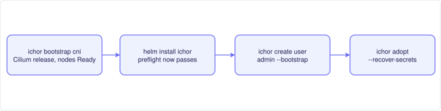

# A cluster with no CNI

Its nodes are NotReady, so the chart's pods cannot start and `helm install --wait` would hang. The chart's preflight refuses to install and says so.



*Bootstrap the CNI first.*

```sh
ichor bootstrap cni --kubeconfig FILE --kube-proxy enabled|replaced [--tunnel vxlan|geneve] [--cilium-values FILE]
helm install ichor ichor/ichor --version X.Y.Z \
  --namespace ichor-system --create-namespace \
  --set ichorUI.users.enabled=true --set ichorUI.users.externalURL=https://localhost:8443
ichor create user admin --role admin --generate --bootstrap
ichor adopt --cluster NAME --node ADDR --recover-secrets --recover-from ADDR
```

- `ichor bootstrap cni` refuses unless the cluster has no CNI (no CNI workload, no `CiliumNode` CRD, every node NotReady). It installs the pinned Cilium as Ichor's own Helm release (`cilium` in `kube-system`, record in `ichor-system`), waits for Ready nodes, and asks first unless `--yes`. Running it again is safe.
- `--kube-proxy` is required: `enabled` if Talos runs kube-proxy, `replaced` if Talos disables it. The command has no Talos credentials, so it cannot read this, and it does not delete a kube-proxy that is already running: `replaced` is refused while the `kube-proxy` DaemonSet exists. Disable kube-proxy when you generate the machine config: setting it later stops Talos managing the DaemonSet but leaves it running, and Cilium and kube-proxy then route Services independently. Delete the `kube-proxy` DaemonSet and ConfigMap in `kube-system` first, or use `enabled` and switch later with `ichor set kube-proxy replaced`. `--tunnel` is immutable afterwards.
- KubePrism must be enabled on port 7445 on every node (the Talos default); adopt checks it later.
- `ichor adopt` finds Cilium by its Ichor release record and checks tunnel and kube-proxy mode against it. What adopt does on a Helm install: [Adopt, when Ichor was installed with Helm](../adopt-a-cluster/with-helm.md).
