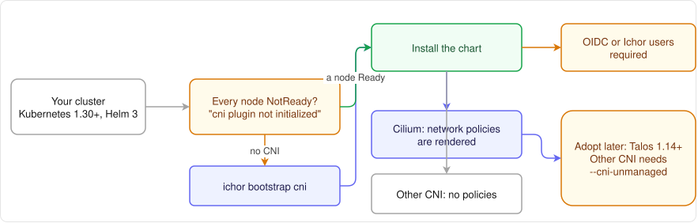

# What the install needs

The chart asks for little. Installing it and managing a cluster are two steps.

*What the chart needs, and what waits for adopt.*

| Condition | What happens |
|---|---|
| Kubernetes 1.30+, Helm 3 | The chart declares `kubeVersion >=1.30.0-0`; Helm refuses older. `install.yaml` and `ichor init` declare no minimum and do not read the server version, so below 1.30 they install without the kube-proxy-switch guard (ValidatingAdmissionPolicy is Stable from 1.30). |
| A working pod network | Every node NotReady with "cni plugin not initialized": the chart refuses and says to run `ichor bootstrap cni` ([no CNI](no-cni.md)). One Ready node passes. |
| Cilium | Not needed to install. With it, the chart also renders [network policies](network-policies.md). |
| Another CNI | The chart installs, leaves the CNI alone and renders no policies, so Ichor does not isolate `ichor-system`. `ichor adopt` refuses the cluster unless you pass `--cni-unmanaged`, which keeps the CNI as is and refuses the Cilium commands (`get`/`edit`/`apply`/`diff cni-values`, `upgrade cni`, `set kube-proxy`). Ichor does not migrate a CNI. |
| talosconfig, secrets bundle, kubeconfig | Not needed to install; they go to `ichor adopt`. Every node must be Talos v1.14+ (a node added later with `--add-machine`: v1.12+), and a new cluster needs a v1.14+ version contract probed on its first control plane: [Adopt a running cluster](../adopt-a-cluster/before-you-start.md#what-you-need). |
| OIDC or Ichor users | Required: ichor-ui does not start without sign-in, and the chart refuses to render it with neither. Set `ichorUI.users.enabled` with `ichorUI.users.externalURL` (the install below uses `https://localhost:8443`, reached with `ichor ui`), or `ichorUI.oidc`, or `ichorUI.enabled=false`. See [Users and login](../users-and-login.md). |
