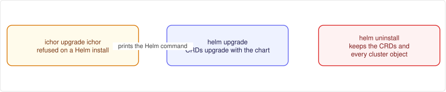

# Upgrade and uninstall

*Helm owns upgrade and uninstall.*

- Upgrade with `helm upgrade`; the CRDs are in the chart's templates and upgrade with it.
- An upgrade from v0.2.x moves each patch's `spec.documents` to `spec.config` by itself: a post-upgrade hook Job runs the controller image's `migrate-patches` under a ServiceAccount that exists only while it runs. A patch it cannot move is left as stored with `Migrated=False`, and the upgrade still succeeds; `ichor migrate patches` does it again by hand. The controller applies a change that needs no reboot by itself. `ichor rollout config` rolls out only what waits for you: nodes at `RebootRequired`, and control planes at `APIServerRestartRequired` (the restart that sign-in needs). A migration alone changes nothing on a node, because a setting that only moved renders the same.
- `ichor` commands that would run the installer Job refuse and print the Helm command. The UI's Helm detection is limited, so some of its upgrade prompts may still describe the installer path.

> [!IMPORTANT]
> `helm uninstall` keeps the CRDs by default (`crd.keep: true`), and so every cluster object. Cilium is a separate release and stays.

> [!WARNING]
> Do not delete the namespace Ichor runs in (`kubectl delete namespace ichor-system`) while it holds a cluster. Ichor refuses to delete its TalosClusters and TalosMachines, so the namespace stays `Terminating`, and it refuses to delete the secrets bundle Secret (label `ichor.maesh.dev/protected`) for the same reason. Remove the cluster on purpose: set the annotation `ichor.maesh.dev/allow-delete=true`, then delete the TalosClusters and TalosMachines. Export the bundle first (`ichor export bundle`); the bundle Secret needs the same annotation before it can go.

For an Ichor the installer made, see [Upgrade Ichor with the installer](../upgrade-ichor.md).
