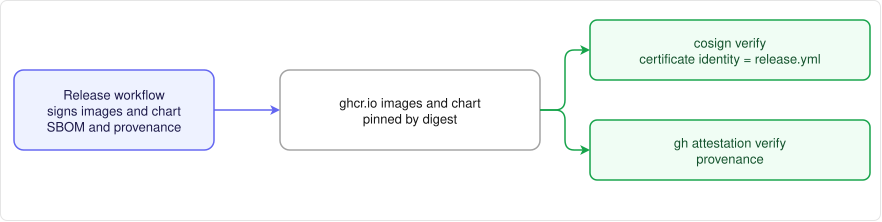

# Verify a release



*Verify by digest against this repository's release workflow.*

Every release image (`ichor-controller`, `ichor-ui`, `ichor-installer`) and the chart is signed keylessly with cosign by the release workflow, with an SPDX SBOM and a build provenance attestation.

```sh
cosign verify ghcr.io/maeshinshin/ichor-controller:vX.Y.Z \
  --certificate-oidc-issuer https://token.actions.githubusercontent.com \
  --certificate-identity-regexp '^https://github.com/maeshinshin/ichor/\.github/workflows/release\.yml@refs/tags/v.*$'
gh attestation verify oci://ghcr.io/maeshinshin/ichor-controller:vX.Y.Z --repo maeshinshin/ichor
```

- The same `cosign verify` covers `ichor-ui`, `ichor-installer` and the chart (`ghcr.io/maeshinshin/charts/ichor:X.Y.Z`).
- `ichor upgrade ichor` checks the installer image itself ([The installer image on an upgrade](installer-image.md)). `helm upgrade` does not: verify as above, or enforce signatures with your own admission policy.
- The installer's manifest and the chart's default images name `ichor-controller` and `ichor-ui` by digest (`...:vX.Y.Z@sha256:...`), so a verified signature covers exactly the images the release built, not what a tag points at later.
- Each release's base image is pinned by digest (annotation `org.opencontainers.image.base.digest`). Builds are reproducible from the tag: same commit, same Nix shell, same binaries (`-trimpath`, stripped, no timestamps).
- The CLI binary itself: `ichor upgrade cli` verifies the release's checksums against its Sigstore bundle, and has no way to skip the check.
