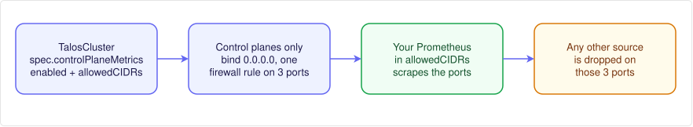

# Expose control-plane metrics

Talos binds the metrics of kube-controller-manager, kube-scheduler and etcd to
localhost. `spec.controlPlaneMetrics` on the `TalosCluster` opens them to the
sources you name. Ichor installs no monitoring: the Prometheus, the scrape
configuration and the alerts are yours.



*What the field changes, and who may reach it.*

## Turn it on

It is off by default. Enabling it needs at least one CIDR; a `/0` is rejected, and
so is enabled with no CIDR, in the CRD and again at render. Up to 8 CIDRs, IPv4
or IPv6.

```yaml
apiVersion: ichor.maesh.dev/v1alpha1
kind: TalosCluster
metadata: {name: lab, namespace: ichor-system}
spec:
  controlPlaneMetrics:
    enabled: true
    allowedCIDRs: [10.20.0.0/16]
```

`allowedCIDRs` must cover wherever your Prometheus runs, as the nodes see its
address: the pod CIDR or the node CIDR, depending on the CNI and masquerading.
Other nodes are dropped too. A scraper on the node itself still works. Disabling
keeps `allowedCIDRs`, so toggling loses nothing.

## What it renders

On control planes only, in the system layer (a `TalosConfigPatch` cannot write
these kinds):

| Component | Change |
|---|---|
| kube-controller-manager | `bind-address: 0.0.0.0` |
| kube-scheduler | `bind-address: 0.0.0.0` |
| etcd | `listen-metrics-urls: http://0.0.0.0:2381` |
| Firewall | one `NetworkRuleConfig`, `ichor-control-plane-metrics`, for TCP 2381, 10257 and 10259: sources outside `allowedCIDRs` are dropped |

Talos's default firewall action stays `accept`. Ichor never renders
`NetworkDefaultActionConfig`, so the Kubernetes API, etcd client and peer ports,
the kubelet and the Talos API are not touched.

## Reboots

| Change | Applied |
|---|---|
| Firewall rule, controller-manager and scheduler arguments | Live, no reboot |
| etcd argument | Needs a reboot of each control plane, one at a time, through the usual reboot path |

## Scrape it

| Target | Auth |
|---|---|
| `https://NODE:10257/metrics` (controller-manager) | Bearer token with RBAC for `/metrics` |
| `https://NODE:10259/metrics` (scheduler) | Bearer token with RBAC for `/metrics` |
| `http://NODE:2381/metrics` (etcd) | None: the source restriction is the control |

Ichor ships no `ServiceMonitor` for these: the chart cannot know your node
addresses. Write a scrape of the node IPs in your own stack. etcd also serves
mTLS metrics on 2383; that port needs a client certificate and is not touched.

## Ichor's own metrics

A separate setting, from the Helm chart. The controller's metrics port (8443) is
closed to every pod until you name a source:

| Value | Meaning |
|---|---|
| `networkPolicy.cilium.metricsNamespaces` | Namespaces whose pods may connect. Empty: nobody. |
| `networkPolicy.cilium.metricsPodLabels` | Narrows those namespaces to pods with these labels. |

The endpoint also checks the caller's token. `ichor-ui`'s `/metrics` shares the UI
port, so no network rule can separate it; the token check is its restriction. See
[Network policies](install-with-helm/network-policies.md) for the install paths
that carry no value for this and the policy to write instead.
