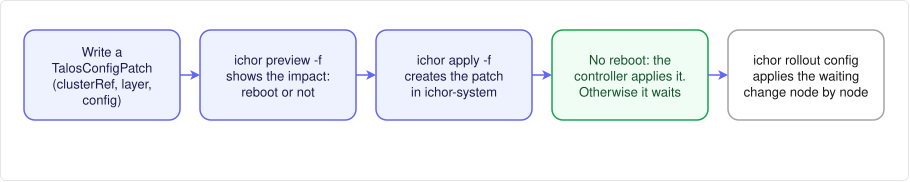

# Patch the Talos machine config

A `TalosConfigPatch` changes machine configuration with the Talos machinery
types, no raw YAML. The controller merges the patches and applies the result to
the nodes.



*From the manifest to the nodes.*

## A minimal patch

```yaml
apiVersion: ichor.maesh.dev/v1alpha1
kind: TalosConfigPatch
metadata: {name: time-servers, namespace: ichor-system}
spec:
  clusterRef: {name: demo}
  layer: cluster
  config: {machine: {time: {ntp: {servers: [time.cloudflare.com, pool.ntp.org]}}}}
```

```sh
ichor preview -f patch.yaml   # impact only, writes nothing
ichor apply -f patch.yaml
```

```console
$ ichor preview -f patch.yaml
Impact
  ✓ no reboot needed; nothing install-time-only or too new for the cluster's Talos
$ ichor apply -f patch.yaml
✓ created patch time-servers · ichor-system
```

## Look at it

```sh
ichor get patches
ichor describe patch time-servers
ichor describe config NODE      # the rendered config, each value tagged with its layer
```

## When it takes effect

- No reboot: the controller applies it.
- A reboot, or an API-server restart: it waits. Run `ichor rollout config
  --cluster demo --follow`; it goes one node at a time. With one control plane
  the Kubernetes API is unavailable during the step.

## Layers

`spec.layer` is one of these; `spec.priority` (default 0) orders patches inside a layer.

| Layer | `spec.target` |
|---|---|
| `cluster` | none |
| `role` | `role` |
| `selector` | `labelSelector` (matches `spec.nodeLabels`) |
| `machine` | `machineRef` (one TalosMachine) |

Every field: [TalosConfigPatch reference](../reference/crds/talosconfigpatch.md).
The same editor is on the Configuration page of the UI ([The web UI](the-web-ui.md)).
