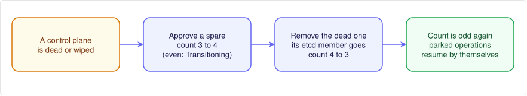

# Replace a control plane

A control plane that is dead, or whose disk was wiped, is replaced without
losing etcd quorum. Ichor does most of it; you approve a spare and remove the
dead node.



*Add first, then remove: three to four to three.*

## The even-count rule

While the number of approved control planes is even, the cluster is
`Transitioning` (reason `EvenControlPlaneCount`). An even etcd has no majority
margin, so:

| Effect while even | Detail |
|---|---|
| Every operation is refused at the plan | Except an etcd restore, which is a recovery. The plan says to remove one control plane or approve another. |
| An operation already created is parked | `Paused`, reason `ClusterTransitioning`. It holds no lock, and resumes by itself once the count is odd. |
| Removing a control plane is allowed | It is how the count returns to odd. A parked operation does not block it. |
| Resetting a control plane is refused | Remove the node instead. |

`kubectl get talosclusters` shows the `Transitioning` column. Approve a spare
first, so the cluster is never below its declared `spec.controlPlane.count`.

## Steps

1. Check the cluster: `kubectl -n ichor-system get talosclusters`. Note the
   `Transitioning` column and the dead node's `Ready` condition
   (`NodeUnreachable` names the endpoint and, when the Node shows a new
   InternalIP, the likely new address; `spec` is never changed for you).
2. Boot a spare in maintenance mode and approve it:

   ```sh
   ichor approve node UUID --role controlplane --hostname cp-4 --install-disk /dev/sda
   ```

   The count is now even. The spare's etcd can stay in `Preparing` while the
   dead member is still listed; that ends in step 3.
3. Remove the dead one. It needs `--override` and the override verb on the node; the typed node
   name is the confirmation:

   ```sh
   ichor delete node cp-2 --override --follow
   ```

   The plan allows a removal below the declared count when the machine's `Ready`
   is `False` with reason `NodeUnreachable`. The controller then reads etcd through a
   healthy control plane and goes on only when the member is unreachable,
   failing its status or seeing no leader. It skips the drain and the storage
   evacuation, and writes the Warning Event `DeadMemberRemoved`.
4. Check that `Transitioning` is `False` and the control-plane count is the
   declared one.

## Refused whatever you do

| Case | Why |
|---|---|
| Removing one of two control planes | Below etcd quorum. |
| Removing the last control plane | Delete the `TalosCluster` instead, then its machines; they are released and the nodes keep running. |
| Removing a member etcd answers for with a leader | It is healthy. |
| A node whose etcd member cannot be told apart | Nothing proves it dead. |

## What Ichor does by itself

| Situation | What happens |
|---|---|
| A wiped or replaced disk: an approved node answers in maintenance mode with its recorded identity | The configuration is sent again. This is the automatic re-provision of a wiped control plane or worker, with no approval. Event `NodeReinstalled`. |
| A re-provisioned control plane that etcd still lists | The stale member is removed through a surviving control plane first. Event `StaleEtcdMemberRemoved`. |
| Re-provision cannot start | Nothing is sent. Reasons `ReprovisionBlocked` or `StaleEtcdMember` say why; with no node name recorded, set `spec.hostname`. |
| The control plane held the only etcd data | Recover from a backup with `ichor restore cluster`. |
| A node moved to a new address | Followed through status when it has a hostname. |

The re-provision uses the first provisioning's checks: the identity must match
the approval, the SecureBoot requirement and the install disk, and, for a
control plane, the cluster lock.

See [Reclaim a machine](reclaim-a-machine.md) for a node that still holds its
configuration, and [Back up etcd to S3](etcd-backup.md) for the backup the
restore reads.
