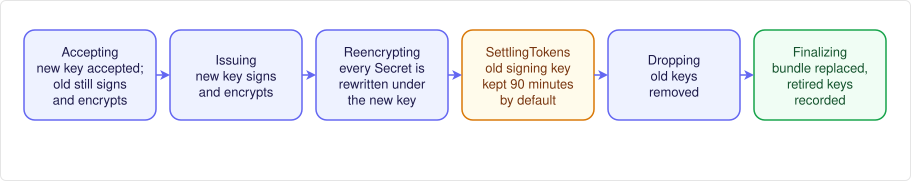

# Rotating the service-account and secretbox keys

`ichor rotate keys` replaces the **service-account signing key** (signs every
ServiceAccount token) and the **secretbox key** (encrypts Secrets in etcd).
`ichor rotate ca` replaces the certificate authorities, including etcd and
aggregator (`--ca etcd`, `--ca kubernetes-aggregator`, `--all`).



*Both keys overlap until Dropping; each stage is verified on every control plane first.*

| Stage | Service-account key | Secretbox key |
|---|---|---|
| `Accepting` | new public key accepted; old still signs | new key added as a second, decrypt-only provider |
| `Issuing` | new key signs; old still accepted | new key encrypts; old still decrypts |
| `Reencrypting` | | every Secret rewritten, a page at a time with the position kept in status; ends after a sweep that rewrote nothing |
| `SettlingTokens` | old key kept while pods' tokens are re-issued, until no legacy token Secret depends on it | |
| `Dropping` | old public key removed | old key removed |
| `Finalizing` | bundle in the cluster replaced, retired keys recorded | |

A stage that does not apply is skipped. Control planes are reconfigured one at a
time, each kube-apiserver is awaited, so the API stays up with more than one
control plane. No node reboots and your kubeconfig and talosconfig keep working.

## Run it

```sh
ichor rotate keys NAME
```

It shows the plan and asks to confirm (`--yes` skips). The UI has **Rotate keys**
in the cluster menu. You need the `start` verb on `talosoperations/key-rotation`
(`ichor-admin` has it).

| Flag | Effect |
|---|---|
| `--only service-account` or `--only secretbox` | rotate one key |
| `--token-settle 2h` | keep the old signing key longer (default 90 minutes; **under 75 minutes is refused**, since pods, Ichor's controller, the CNI and CoreDNS still hold old tokens until the kubelet refreshes them) |
| `--ignore-legacy-tokens` | drop the old key although `kubernetes.io/service-account-token` Secrets it signed exist; delete such a Secret's `token` key to have a new one written |
| `--follow` | report progress until it ends |

- When the new key signs, Ichor rolls its own controller and ichor-ui once
  (the operation resumes by itself) and waits for them before dropping the old key.
- Tokens kept outside the cluster, or requested with a lifetime longer than
  `--token-settle`, stop working when the old key is dropped.

## Before and during

- Every control plane must answer with its rendered configuration, have a ready
  kube-apiserver, and every Node must be Ready. The cluster needs
  `versionContract` v1.14 or later.
- A step that cannot be verified pauses the operation (`Blocked` on the
  `KeyRotation` condition) and continues when the cause is gone.
- A cause no waiting clears (a `versionContract` below v1.14, no secretbox secret
  in the bundle, a `keyrotation.yaml` holding other keys, a `TalosConfigPatch`
  that overrides the key documents) pauses it at once as a failed step and frees
  the cluster lock. Fix the cause, then `ichor resume operation NAME`.
- Nothing is rolled back: every stage keeps both keys working.
- The machine controller does not reconcile control planes, and other disruptive
  operations are refused, while it runs. The new keys are kept in the bundle
  Secret (`keyrotation.yaml`) before any node uses them.

## Afterwards

1. `ichor export bundle NAME`. The bundle now holds `retired-keys.yaml` (the old
   secretbox secret and the old service-account key's fingerprint). Keep it next
   to the bundle: without it a backup sealed before the rotation cannot be opened.
2. `ichor defrag etcd` on each control plane: older etcd revisions, snapshots
   and backups stay under the old key until compaction drops or you delete them.

New backups use the new key. A **snapshot taken before the rotation finished
cannot be restored** into the running cluster; Ichor refuses it and names the
operation. `ichor restore cluster` can open it with the exported bundle and
`retired-keys.yaml`, but its Secrets are under the retired secretbox key, so run
the cluster from the bundle that matches that snapshot.
