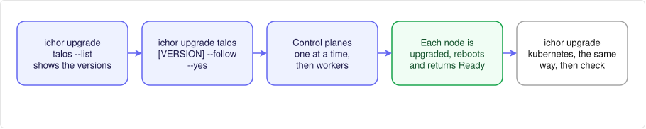

# Upgrade Talos and Kubernetes

`ichor upgrade talos` and `ichor upgrade kubernetes` create a `TalosOperation`;
the controller upgrades control planes one at a time, then workers.



*Talos first, then Kubernetes.*

## Talos

```console
$ ichor upgrade talos --list
VERSION  KIND   DEFAULT
v1.14.7  patch  ✓
v1.14.6  patch  -
$ ichor upgrade talos --follow --yes
using v1.14.7 (the newest listed)
Upgrade Talos on cluster "demo" from v1.14.5 to v1.14.7.
Each node is upgraded and REBOOTS.
…
✓ talos — Completed (6m02s)
```

- `ichor upgrade talos VERSION` picks a version; without it the default is used.
- Without `--yes` the plan is shown and you are asked.

## Kubernetes

```sh
ichor upgrade kubernetes --list
ichor upgrade kubernetes --follow --yes
```

When there is nothing newer, `--list` prints `✓ kubernetes is on the newest
release this Ichor allows`.

> [!WARNING]
> With one control plane the Kubernetes API is unavailable while it reboots or
> restarts its API server. `--follow` prints `API unreachable, retrying` until it returns.

A failed step pauses the operation; see [Check the
cluster](getting-started/check-the-cluster.md) for `ichor resume operation`.
