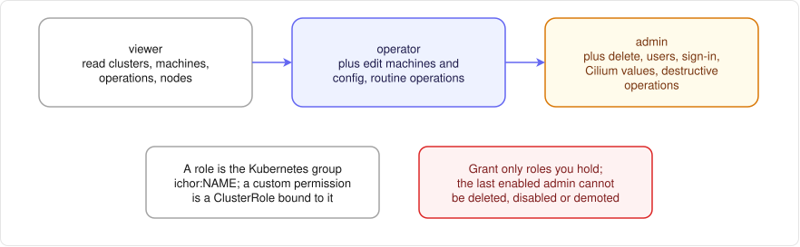

# Create users and roles



*Each role includes the one before it; two rules keep the roles from being worn away.*

A user is an `IchorUser` in `ichor-system`, created with the CLI or applied
yourself. Its name is the login name and cannot change. It has a display name
and e-mail (informational), `roles` and `disabled` (false for a new user).

A custom permission is a ClusterRole bound to the group `ichor:<name>` of the
user. No built-in role can read secrets.

Changing the Cilium Helm values needs `update` on `talosclusters/cilium-values`,
which only `admin` holds ([Cilium](../hardening/cilium.md#cilium-helm-values)).
To let someone else, bind a ClusterRole with that verb to their group.

## Passwords

- A new user has no password until an admin sets one or asks for a generated one (shown once).
- A password is 12 to 128 bytes, with no other rules. Users change their own in the account menu.
- A password set by an admin is must-change. The forced first-login form asks no current password, and needs a sign-in within the last 10 minutes: sign in again if it says it is stale.

## Two rules

- A user may grant only roles they hold (admin: any). A validating webhook on `ichorusers` applies this to `kubectl` writes made as an Ichor user; an external identity is gated by RBAC alone.
- The last enabled admin cannot be deleted, disabled or demoted, in the UI, CLI or `kubectl`. Exempt: the `system:masters` override certificate, the controller, and Kubernetes namespace deletion (so deleting `ichor-system` still works).

## The `ichor user` commands

They talk to ichor-ui directly at the issuer URL over https, with your login (a
token for ichor-ui; the first command opens the browser). No port-forward or
kubeconfig, so they work from a laptop. Give the URL with `--issuer` or
`ICHOR_ISSUER`, and `--ca-file` (or `ICHOR_CA_FILE`) when a private CA signed
ichor-ui's certificate. `-o yaml` or `-o json` print the full response for scripts.

```sh
ichor get users
ichor describe user alice
ichor create user alice --display-name "Alice" --role viewer --generate
ichor edit user alice --role operator        # only the flags you pass change
ichor edit user alice --disabled=true
ichor user set-password alice --password-stdin
ichor user revoke-sessions alice
ichor delete user alice                        # asks; --yes skips
```

```console
$ ichor get users
NAME   DISPLAY NAME  EMAIL  ROLES   STATE        AGE
admin  -             -      admin   active       2d
alice  Alice         -      viewer  no password  4s

$ ichor create user bob --role viewer --generate
✓ created user bob (viewer)
! Password for bob (shown once, stored nowhere; they must change it at the first sign-in): Zq3x...
```

`STATE` is `active`, `no password` (nobody can sign in yet) or `disabled`.

`create` and `set-password` read the password from a no-echo prompt (asked
twice), the first line of stdin with `--password-stdin`, or `--generate`, which
prints it once to stderr under the result line. Never a flag value. RBAC
decides who may do what: `admin` for everything, `update` on
`ichorusers/password` for `set-password` and `revoke-sessions`.
