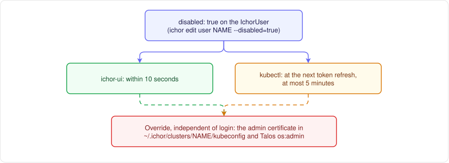

# Disable a user and the override



*A token already issued cannot be taken back; its 5-minute lifetime is the limit.*

## Disable a user

Set `disabled: true` on the `IchorUser`, with `ichor edit user NAME
--disabled=true` or kubectl. ichor-ui applies it within 10 seconds; `kubectl`
at the next token refresh, at most 5 minutes later.

To end every session of a user without disabling them, run `ichor user
revoke-sessions NAME`. What ends a session, and what keeps running for a few
minutes, is in [Sign-in and sessions](../../concepts/sign-in-and-sessions.md).

## Override

Ichor keeps a credential that does not depend on login: the `admin` client
certificate in `~/.ichor/clusters/<name>/kubeconfig`, and the Talos `os:admin`
identity in the same folder. Use it when ichor-ui is down, the issuer is
broken, or every user is locked out.

> [!WARNING]
> Once users are on, keep that folder offline and use it only in an incident.

- The bundle there (`secrets.yaml`) is passphrase-encrypted ([The local secrets bundle](../hardening/secrets-bundle.md)); the kubeconfig is not, because `kubectl` reads it directly.
- The bundle holds the CAs. With it, `ichor create credentials --bundle` makes a new kubeconfig and talosconfig even when the cluster is unreachable and no kubeconfig is left:

  ```sh
  ichor create credentials NAME --bundle secrets.yaml --kube-server https://<address>:6443 --talos-endpoints <address>
  ```

  The bundle holds no addresses, so note them with it.
- Without the file, the cluster's copy of the bundle can be read with the Role `ichor-bundle-secret-role` (chart value `rbac.bundleSecret.names`), which grants `get` on that one Secret and nothing else. Bind it only to people you would give `os:admin`.

This is not the `override` write, an RBAC verb that guards destructive operations.
