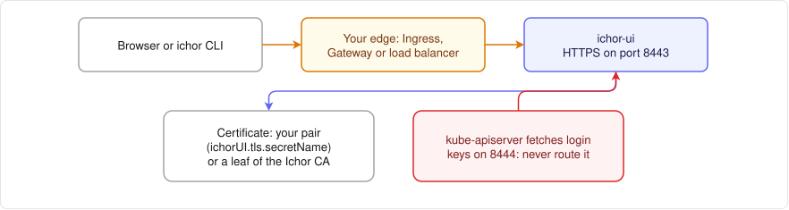

# Expose ichor-ui over https

*One TLS listener on 8443; making it reachable is your job.*

ichor-ui never serves plain HTTP to the network. One listener on port 8443
serves the UI, the API, `/metrics` and the probes over TLS, with one of:

- **Your pair**, `ichorUI.tls.secretName` (or `--ui-tls-secret`), for example a cert-manager Secret. Browsers trust it if the issuer is public.
- **A leaf of the Ichor serving CA** (Secret `ichor-oidc-tls`, issued for every install). Its names: the Service ClusterIP, `ichor-ui-service.ichor-system.svc` and `.cluster.local` (`ichor-ichor-ui-service...` on an `ichor init` install), `localhost` and, when users are on, the host of the external URL.

> [!WARNING]
> Browsers do not trust the Ichor leaf. An edge that terminates the browser's TLS must verify it ([Pick a recipe](#pick-a-recipe)), and a client that connects directly needs the CA.

`ichor init` installs no LoadBalancer, Ingress or Gateway; making ichor-ui
reachable at the `--ui-url` is yours.

## The serving CA

The controller publishes the public part of the Ichor serving CA, never a key,
as the ConfigMap and the Secret `ichor-ui-ca` in `ichor-system` (key `ca.crt`).
Service port 8443 is named `https`. Port 8444 is internal: the kube-apiserver
fetches the login keys there. Never route it from an edge.

## Certificate renewal

ichor-ui reloads its certificate files within about ten seconds of a change,
without a restart, so a `kubernetes.io/tls` Secret that cert-manager renews
works as is (the kubelet copies a changed Secret into the pod on its own
schedule; 25 to 46 seconds in one observed case). An invalid new pair is
ignored: ichor-ui keeps serving the old one and logs the error.

## Pick a recipe

- [Ingress-NGINX](expose-ichor-ui/ingress-nginx.md): re-encrypts to the backend.
- [Gateway API](expose-ichor-ui/gateway-api.md): a `BackendTLSPolicy`.
- [A load balancer that passes TLS through](expose-ichor-ui/load-balancer.md): needs your certificate.

The recipes use the Helm chart's Service name, `ichor-ui-service`. An `ichor
init` or kustomize install prefixes it: `ichor-ichor-ui-service`. Use that for
`name:` and for the verified host name.

## Your own certificate

With your certificate, the edge verifies your CA instead of `ichor-ui-ca`, and
the name it checks must be in your certificate. The `ichor` CLI and in-cluster
clients are unaffected: a handshake with SNI `<service>.<namespace>.svc` gets
Ichor's own certificate, so they still verify against `ichor-ui-ca`. Every
other name gets yours.

## Port 8080 and migration

A new install serves nothing on 8080. `ichor upgrade ichor` moves an install
that served plain HTTP to HTTPS on 8443 and prints "ichor-ui no longer serves
plain HTTP; point your edge at https://...:8443 (trust ichor-ui-ca)".

- `--http-addr` is accepted for one more release as a no-op that logs "ignored".
- The chart value `ichorUI.plaintextPort` is gone.
- An install that served TLS on 8080 keeps `--addr` pinned to 8080.

Chart values: [Install Ichor with Helm](../install-with-helm.md).
