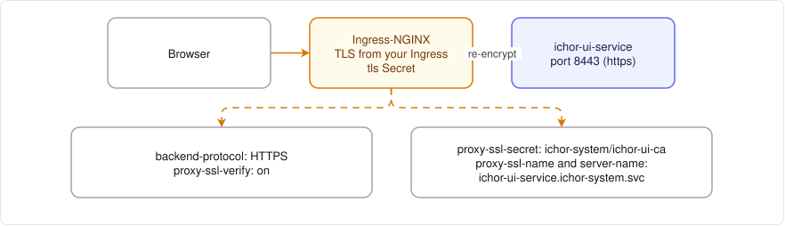

# Ingress-NGINX (re-encrypt to the backend)



*NGINX terminates the browser's TLS and verifies ichor-ui against `ichor-ui-ca`.*

The Ingress must be in `ichor-system`, because it names the Service.

```yaml
apiVersion: networking.k8s.io/v1
kind: Ingress
metadata:
  name: ichor-ui
  namespace: ichor-system
  annotations:
    nginx.ingress.kubernetes.io/backend-protocol: "HTTPS"
    nginx.ingress.kubernetes.io/proxy-ssl-verify: "on"
    nginx.ingress.kubernetes.io/proxy-ssl-secret: "ichor-system/ichor-ui-ca"
    nginx.ingress.kubernetes.io/proxy-ssl-name: "ichor-ui-service.ichor-system.svc"
    nginx.ingress.kubernetes.io/proxy-ssl-server-name: "on"
spec:
  ingressClassName: nginx
  tls:
    - hosts: [ichor.example.com]
      secretName: ichor-example-com-tls
  rules:
    - host: ichor.example.com
      http:
        paths:
          - path: /
            pathType: Prefix
            backend:
              service:
                name: ichor-ui-service
                port:
                  name: https
```

| Annotation | Why |
|---|---|
| `backend-protocol: "HTTPS"` | NGINX speaks TLS to the pod |
| `proxy-ssl-verify` | Off by default; without it NGINX does not check the pod's certificate |
| `proxy-ssl-secret` | `namespace/secretName`. A Secret with only `ca.crt`, which `ichor-ui-ca` is, works (chart 4.15.1, controller 1.15.1). Another CA gives 502 (`upstream SSL certificate verify error`) |
| `proxy-ssl-name`, `proxy-ssl-server-name` | Required. The name NGINX verifies, sent as SNI; it must be in the certificate. Without it NGINX verifies `upstream_balancer`, and a wrong name gives 502 (`certificate does not match`) |

- The browsers' certificate is the Ingress's own `tls` Secret.
- With your own certificate, point `proxy-ssl-secret` at a Secret holding its CA as `ca.crt`.
- NGINX takes up to about half a minute to reload after an annotation change: wait before reading a result.
