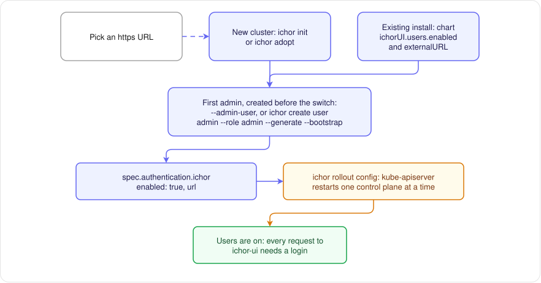

# Turn users on



*The first admin exists before the switch, so nobody is locked out.*

`ichor init` turns users on by default, with the issuer
`https://localhost:8443` (where `ichor ui` serves ichor-ui) unless you pass
`--ui-url`. The Helm chart has no default: it refuses an ichor-ui with neither
`ichorUI.users.enabled` nor `ichorUI.oidc` ([Without any sign-in](without-sign-in.md)).

## Before you start

- An https URL that browsers and the `ichor` CLI can reach. `https://localhost:8443` works through `ichor ui`'s port-forward; any other address is yours to provide.
- A Talos v1.14 contract or later: older ones cannot carry the issuer configuration.
- A rollout to the control planes with `ichor rollout config`: the kube-apiserver reads its login settings from the machine config. `ichor init` runs it for you and waits.

## On a new cluster

Sign-in is on by default, and `ichor adopt` turns it on the same way, with the
same flags ([Adopt a running cluster](../adopt-a-cluster.md)). To reach
ichor-ui at your own address:

```sh
ichor init --ui-url https://ichor.example.com --admin-user admin ...
```

`ichor init` installs from the manifest in the binary and applies in place what
`ichorUI.users.enabled` and `externalURL` render (ichor-ui flags, internal
port, key volumes, the empty `ichor-user-credentials` Secret). Then it creates
the first admin (`--admin-user`, default `admin`, role `admin`) and sets
`spec.authentication.ichor`, in that order. It prints the matching Helm values
and the generated password to stderr, and retries transient API errors for a
few minutes.

> [!WARNING]
> The password is printed once, even when a later step failed, and is stored
> nowhere; the first login forces a change. Save it.

Four more flags, on `ichor init` and `ichor adopt`, are checked before anything
is written:

| Flag | Chart value | Effect |
|---|---|---|
| `--ui-tls-secret NAME` | `ichorUI.tls.secretName` | Mounts the `kubernetes.io/tls` Secret `NAME` (in `ichor-system`), sets `--tls-cert-file` and `--tls-key-file`, probes over HTTPS |
| `--ui-tls-cert FILE` with `--ui-tls-key FILE` | `ichorUI.tls.secretName` | Stores the PEM pair as the Secret `ichor-ui-tls` and uses it the same way; the key is never printed |
| `--kube-api-server-url URL` | `ichorUI.users.kubeAPIServerURL` | The https URL in users' kubeconfigs (default: the cluster's `spec.endpoint`) |
| `--kube-api-tls-server-name NAME` | `ichorUI.users.kubeAPITLSServerName` | The `tls-server-name` in users' kubeconfigs, for a host outside the kube-apiserver certificate |

## Publish at another address

Set the new https URL in `spec.authentication.ichor.url` of the TalosCluster (a
patch needs `update` on `talosclusters/authentication`), run `ichor upgrade
ichor` so the installer applies it to ichor-ui and the controller, then
`ichor rollout config` for the kube-apiserver side. The URL and the token
issuer must match, so sign-in breaks until both are done. Whether an upgrade
at the same version re-runs the installer is not covered here.

## On an existing install

Set `ichorUI.users.enabled: true` and `ichorUI.users.externalURL` to the https
URL in the chart values, then create the first admin before every request needs
a login:

```sh
ichor create user admin --role admin --generate --bootstrap
```

- `--bootstrap` needs no login, because nobody can log in yet. It uses your kubeconfig, so Kubernetes decides: you need `create` on `ichorusers` and `get` and `patch` on the Secret `ichor-user-credentials`.
- The CLI creates the `IchorUser` and writes the argon2id hash into that Secret with the code ichor-ui uses. It never resets an existing name, and refuses a cluster without the Secret (users are not on yet; the chart creates it with `ichorUI.users.enabled`).
- The generated password is printed once to stderr and must be changed at first login. Instead of `--generate`, type it at a no-echo prompt or pipe it with `--password-stdin`.

Then set `spec.authentication.ichor` (`enabled: true`, `url`) on the TalosCluster
(needs `update` on `talosclusters/authentication`) and run `ichor rollout config`
if a change waits for a reboot.

## Control plane rollout

Talos restarts the kube-apiserver on each change (tens of seconds of `/readyz`
down per control plane), without a reboot. Machines report
`APIServerRestartRequired` until `ichor rollout config` (or Apply in the UI
Overview) rolls it out one control plane at a time, no drain, waiting for
`/readyz`. `ichor init` starts that rollout itself before it finishes, so a new
cluster ends Ready; `adopt` leaves the moment to you. With one control plane the API is down while it restarts.
